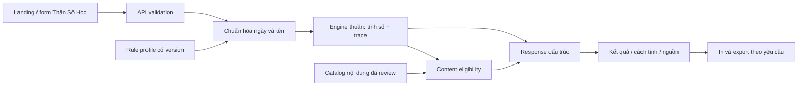

# Roadmap Thần Số Học từ A–Z

> **Phiên bản:** 1.1 · **Ngày cập nhật:** 2026-10-13
> **Trạng thái:** backlog `PROPOSED`, có MVP số học thử nghiệm — xem snapshot §17; chưa phải công thức đã đối chiếu nguồn.
> **Baseline mã nguồn:** `8fc5a01`; phải kiểm kê lại khi kickoff.  
> **Mục tiêu:** triển khai một lĩnh vực Thần Số Học độc lập trong `b3_tuvi`, từ engine đến trải nghiệm landing, có thể giải thích cách tính và kiểm thử được.  
> **Không ấn định ngày phát hành.** Sprint bên dưới là giai đoạn theo dependency, không phải cam kết thời gian.

## 1. Cách sử dụng roadmap

Đây là kế hoạch mới cho **Thần Số Học**, không thay thế [roadmap Tử Vi Sprint 9–14](ROADMAP_SPRINT_9_14.md), [Master Plan V2](AUTODEV_MASTER_PLAN_V2.md), [Contributing](CONTRIBUTING.md) hoặc [Agent Engineering](AGENT_ENGINEERING.md).

Khi triển khai:

1. Kiểm kê HEAD, những gì đã có, CI và thay đổi của người dùng.
2. Hoàn thành quyết định domain tại §4; ghi thành rule profile có version.
3. Chọn các task sẵn sàng theo dependency ở §12; không bắt đầu từ việc viết lời luận.
4. Mỗi task có mã `NUM-*`, output, test và tiêu chí hoàn thành.
5. Khi hoàn thành, gắn commit/report thực tế vào checklist; không đánh dấu bằng việc chỉ tạo file rỗng hoặc script chưa chạy.
6. API, file và command có ghi **dự kiến** chưa tồn tại cho đến khi task tương ứng được triển khai.

Các công thức trong tài liệu là **baseline đề xuất để review**, không tuyên bố là quy tắc duy nhất của mọi trường phái, không tự tạo cờ `authenticated`, `expert_verified` hoặc `approved` cho nguồn/nội dung.

## 2. Mục tiêu sản phẩm và ranh giới

### 2.1. Trải nghiệm đích

Người dùng từ landing page chọn Thần Số Học, nhập ngày sinh dương lịch và họ tên nếu muốn, rồi nhận:

- Các chỉ số từ ngày sinh; chỉ số từ họ tên nếu đủ dữ liệu.
- Mỗi kết quả có cách tính, quy tắc đang dùng và giới hạn.
- Nội dung ngắn, dễ đọc, có nguồn/trạng thái review; có thể mở phần giải thích chi tiết.
- Biểu đồ ngày sinh trực quan, không cần hiểu thuật ngữ trước.
- In/tải kết quả theo lựa chọn của người dùng; không cần đăng nhập.
- Kết quả mới luôn đi cùng input đã gửi, không bị request cũ ghi đè.

Thần Số Học giữ phong cách riêng, dự kiến tím/kem; dùng chung logo, menu trên cùng, accessibility và các primitive form/button với Tử Vi. Không dựng dashboard quản trị cho trải nghiệm công khai.

### 2.2. Phân kỳ năng lực

| Mức | Phạm vi | Điều kiện phát hành |
|---|---|---|
| Preview tại baseline 1.0 | Trang `/than-so-hoc`, giới thiệu và thông báo đang phát triển | Đã có, chưa phải công cụ tính |
| MVP tính toán | Ngày sinh, tên, chỉ số cốt lõi, trace, nội dung đủ điều kiện, UI kết quả | Profile + fixtures + API + UX + tests đạt; thiếu nội dung thì hiển thị số/cách tính |
| V1 đầy đủ | Biểu đồ ngày sinh, chu kỳ cá nhân, đỉnh cao/thử thách, export và nội dung rộng hơn | Mỗi nhóm công thức/nội dung qua gate riêng |
| V1.1 mở rộng | Nhiều rule profile, các chỉ số bổ sung có nguồn | Versioning và kiểm tra dị bản rõ ràng |
| AI tùy chọn | Diễn đạt/giải thích dữ liệu server đã tính | Có bộ đánh giá riêng; không bắt buộc để phát hành MVP/V1 |

### 2.3. Ngoài phạm vi

Không đưa đăng ký, đăng nhập, hồ sơ, lịch sử sinh, đồng bộ cloud, thanh toán hoặc dashboard vào backlog dưới tên khác. Không thêm chức năng tương hợp cặp đôi, luận tên em bé hoặc dự báo sức khỏe/tài chính như điều kiện hoàn thành V1.

Không dùng LLM để tính số, suy chữ nguyên âm hoặc quyết định trường phái. Không gom Tử Vi và Thần Số Học thành một “điểm số cuộc đời”. Không giới thiệu các kết quả như phương pháp khoa học đã được xác nhận.

## 3. Baseline và nguyên tắc kiến trúc

### 3.1. Những gì thực sự đang có

| Hạng mục | Trạng thái tại baseline |
|---|---|
| Landing và menu lĩnh vực | Có; không gian Thần Số Học vẫn preview |
| Form/API Tử Vi | Có; ngày sinh + giờ + giới tính |
| Engine Thần Số Học | Chưa có |
| Chuẩn hóa tên cho Thần Số Học | Chưa có; không dùng nhầm validator Tử Vi như engine tên |
| Catalog nội dung Thần Số Học | Chưa có |
| API `/api/numerology/*` | Chưa có |
| E2E | 15 test đã chạy đạt ở cloud; phần Thần Số Học mới kiểm tra preview/navigation |
| CI | Backend, frontend, E2E; runner backend liệt kê file thủ công |
| Database | SQLite của Tử Vi; không cần migration để tính Thần Số Học |

### 3.2. Kiến trúc đích



- Engine không phụ thuộc Express, SQLite, browser, network hoặc clock ngầm.
- Backend là nguồn tính toán; frontend không copy bảng chữ cái/công thức.
- Chia sẻ layout/form/date primitives khi có lợi; engine và dữ liệu domain vẫn riêng.
- Không thay đổi engine Tử Vi, bảng sao hoặc schema hiện tại chỉ để thêm lĩnh vực mới.
- Nội dung JSON được load read-only; kết quả người dùng không lưu server mặc định.
- Runtime có thể dùng helper chung sau khi có test chứng minh tương đương; tránh ép mọi domain vào một schema khổng lồ.

## 4. Quyết định domain cần chốt trước engine

### 4.1. Decision register đề xuất

| ID | Quyết định | Baseline đề xuất | Review / bằng chứng cần có |
|---|---|---|---|
| `D01` | Trường phái | Hệ Pythagorean, profile riêng cho sản phẩm tiếng Việt | Source dossier, phân biệt biến thể từ các sách/tác giả |
| `D02` | Số đặc biệt | Bộ `{11,22,33}` cho một số chỉ số, không áp toàn cục | Matrix theo từng metric; đặc biệt 33 và tuổi đỉnh cao |
| `D03` | Cách tính Đường đời | Tổng tất cả chữ số của ngày/tháng/năm, rồi reduce | So sánh với cách reduce từng thành phần; không trộn hai cách |
| `D04` | Tên sử dụng | Họ tên khai sinh do người dùng nhập; tên thường dùng là tính năng khác | Copy form và nguồn công thức tên |
| `D05` | Tên tiếng Việt | NFD, bỏ dấu kết hợp, `Đ → D`, Latin A–Z | Fixture Unicode; không tự nhận mọi hệ chữ đã hỗ trợ |
| `D06` | Chữ Y | Baseline kỹ thuật: Y là phụ âm | Review ảnh hưởng tên Việt; công bố rõ trước khi submit |
| `D07` | Chu kỳ cá nhân | Năm dương lịch, bắt đầu 01/01; không đổi ở sinh nhật | Nguồn/variant riêng nếu chọn birthday-based |
| `D08` | Ngày sinh / tuổi | Date-only Gregorian, không cần giờ/giới tính | Leap day, timezone và mốc tuổi |
| `D09` | Thiếu tên | Vẫn tính nhóm ngày sinh; nhóm tên unavailable | API/UI phải phân biệt unavailable với giá trị 0 |
| `D10` | Đỉnh cao / thử thách | Công thức đề xuất tại §5.6; giảm Đường đời về 1–9 để tính tuổi | Review các mốc inclusive/exclusive bằng timeline |
| `D11` | Nội dung | Catalog có nguồn + review độc lập với engine | Không suy “số đã tính đúng” thành “lời luận đúng” |
| `D12` | Riêng tư | POST, không lưu sinh/tên mặc định, không query-share tên đầy đủ | Review export, logs, analytics và trình duyệt |

**Definition of Ready:** có profile, spec của từng metric, các quyết định đã ghi nhận, fixtures tính độc lập và trạng thái nguồn. Nếu chưa chốt một metric mở rộng, tiếp tục phần đã đủ điều kiện; không tạo kết quả placeholder giống số thật.

### 4.2. Rule profile dự kiến

```json
{
  "profileId": "pythagorean-vn-v1",
  "profileVersion": "1.0.0",
  "status": "proposed",
  "lifePathMethod": "all-date-digits",
  "masterNumbers": [11, 22, 33],
  "masterPolicy": "per-metric",
  "namePolicy": "latin-vn-nfd-v1",
  "yPolicy": "consonant",
  "personalYearBoundary": "calendar-year",
  "birthDatePolicy": "gregorian-date-only",
  "nonLeapBirthday": "march-1",
  "sourceReferences": []
}
```

`sourceReferences: []` biểu thị chưa có dossier được gắn, không phải cấu hình đủ gate để gọi nguồn đã duyệt. Không nhận profile JSON tùy ý từ client. Client chỉ chọn ID/version có trong allowlist server.

Đổi cách tính, mapping tên, Y hoặc lịch chu kỳ là thay đổi profile semantics: tăng version, cập nhật expected fixtures và release note. Hai kết quả khác version không được so như cùng công thức.

## 5. Đặc tả tính toán đề xuất

### 5.1. Hàm nền và reduction

Định nghĩa `digitSum(n)` cho số nguyên không âm, và `reduce(n, keepMasters)`:

1. Kiểm tra integer hữu hạn, không âm; lỗi input không bị ép thành 0.
2. Nếu metric cho phép 0, trả 0 khi `n=0`; nếu không, dùng lỗi domain/unavailable.
3. Tại mỗi bước, nếu `n` thuộc `{11,22,33}` và `keepMasters=true`, dừng.
4. Nếu `n<10`, dừng; còn lại thay bằng tổng chữ số và lặp.
5. Trả cả kết quả và mọi bước, không chỉ value.

Ví dụ: `reduce(29,true) → 29 → 11`; `reduce(29,false) → 29 → 11 → 2`; `reduce(33,true) → 33`; `reduce(33,false) → 33 → 6`.

Hàm không nhận phép tính dạng chuỗi để `eval`. Trace do engine dựng từ bước tính thật. `rootValue` luôn giảm về 1–9 cho chỉ số dương; trường hợp master giữ cả `value`, `rootValue`, `isMaster`.

| Metric | Giữ 11/22/33? | Ghi chú |
|---|---|---|
| Đường đời | Có | Tổng toàn bộ chữ số ngày sinh rồi reduce |
| Ngày sinh | Có | Reduce số ngày; chỉ có thể gặp 11/22, ngày 33 không tồn tại |
| Thái độ | Không | Tổng chữ số ngày + tháng |
| Sứ mệnh / Biểu đạt | Có | Tổng chữ cái họ tên |
| Linh hồn | Có | Tổng nguyên âm theo policy |
| Nhân cách | Có | Tổng phụ âm theo policy |
| Trưởng thành | Có | Tổng value Đường đời + Biểu đạt theo profile này |
| Năm/tháng/ngày cá nhân | Không | Giảm về 1–9 |
| Đỉnh cao | Có | Reduce tổng thành phần được quy định ở §5.6 |
| Thử thách | Không | Giá trị 0–8 từ hiệu tuyệt đối |

Một hàm reduction chung không đồng nghĩa mọi metric có cùng `keepMasters`. Không ép metric sinh ra 33 nếu công thức/miền đầu vào không thể tạo nó.

### 5.2. Chỉ số từ ngày sinh — MVP

Input: `{ year, month, day }` là **ngày Gregorian thật**.

- **Đường đời (`lifePath`)**: `reduce(digitSum(day)+digitSum(month)+digitSum(year), true)`.
- **Ngày sinh (`birthday`)**: `reduce(day, true)`; giữ `originalDay` riêng để giải thích, ví dụ 29 → 11.
- **Thái độ (`attitude`)**: `reduce(digitSum(day)+digitSum(month), false)`.

Không dùng `new Date('YYYY-MM-DD')` rồi lấy giờ địa phương để suy ngày. Validate round-trip các trường date-only, đúng năm nhuận thế kỷ; có thể dùng helper UTC với test hoặc helper lịch thuần. Không chuyển âm lịch, không cần `hour`, `gender`.

Baseline input range: năm `1200`–`2199`, tương thích giới hạn kỹ thuật hiện có; ngày sinh sau `referenceDate` trả lỗi. Giới hạn này là quyết định sản phẩm, không phải giới hạn phép cộng số. Birth date chỉ gồm integer JSON; không dùng `parseInt('15abc')` để chấp nhận input bẩn.

### 5.3. Chuẩn hóa tên tiếng Việt — MVP

Pipeline phải công bố trong phần “Cách tính”:

1. Trim, chuẩn hóa NFC để kiểm tra độ dài **1–100 Unicode code points** khi có tên; phân biệt omitted/blank với sai kiểu.
2. Từ chối control/zero-width characters và ký tự chưa hỗ trợ; không xóa âm thầm để làm đẹp input.
3. Chuyển NFD, bỏ combining marks, đổi `Đ/đ` thành `D`, uppercase.
4. Cho phép A–Z, khoảng trắng, dấu gạch nối `-`, nháy đơn `'` và `’`; chuẩn hóa các separator được hỗ trợ về khoảng trắng đơn. Những separator không tính giá trị.
5. Tokenize nhưng giữ mapping sang chữ gốc cho UI; cộng **mọi chữ cái**, không tự đổi thứ tự họ/tên hoặc bỏ tên đệm.
6. Tên không còn chữ cái sau normalization là lỗi; thiếu tên thì nhóm chỉ số tên trả unavailable.
7. `Æ`, `Ø`, emoji, số, Hán tự và chữ ngoài mapping không tự được transliterate. Báo lỗi dễ hiểu, gợi ý người dùng nhập tên Latin phù hợp; không yêu cầu engine đoán tên.

Độ dài phải được giới hạn cả trước và sau normalization; không tạo chuỗi lớn trong trace. Họ tên hiện là optional, không tự lấy từ form Tử Vi hoặc đồng bộ theo cookie.

Bảng Pythagorean đề xuất:

| Giá trị | Chữ cái |
|---:|---|
| 1 | A, J, S |
| 2 | B, K, T |
| 3 | C, L, U |
| 4 | D, M, V |
| 5 | E, N, W |
| 6 | F, O, X |
| 7 | G, P, Y |
| 8 | H, Q, Z |
| 9 | I, R |

Định nghĩa nguyên âm của baseline: **A, E, I, O, U**. Y luôn là phụ âm trong profile v1 đề xuất; đây là lựa chọn rõ ràng để review, không phải khẳng định đúng cho mọi tên Việt. Nếu sau này có variant Y theo phát âm, phải có policy riêng, fixtures và UI giải thích; không dựa vào một regex hoặc LLM ẩn.

### 5.4. Chỉ số từ tên và Trưởng thành — MVP

- **Biểu đạt/Sứ mệnh (`expression`)**: reduce tổng tất cả giá trị chữ cái, giữ masters.
- **Linh hồn (`soulUrge`)**: reduce tổng nguyên âm, giữ masters.
- **Nhân cách (`personality`)**: reduce tổng phụ âm, giữ masters.
- **Trưởng thành (`maturity`)**: reduce `lifePath.value + expression.value`, giữ masters; chỉ khi cả hai có dữ liệu.

Không có nguyên âm hoặc không có phụ âm thì metric tương ứng trả `status: "unavailable"`, reason `no_vowels`/`no_consonants`, value null. Không đưa 0 vào catalog 1–9 và bịa ý nghĩa.

Kiểm tra bất biến trước reduction: `vowelTotal + consonantTotal === expressionTotal`. Đây là kiểm tra mapping, không xác minh nội dung diễn giải.

### 5.5. Biểu đồ ngày sinh và các tuyến số — V1

Đếm **các chữ số 1–9 trong ngày sinh**, bỏ 0; không thêm Đường đời, số tên hoặc chữ số do engine suy ra. Giữ dữ liệu gốc trước reduction.

```text
3 | 6 | 9
2 | 5 | 8
1 | 4 | 7
```

- Mỗi ô có số lần xuất hiện, ví dụ `1 × 2`; ô vắng ghi “không xuất hiện trong ngày sinh”, không gọi đó là thiếu năng lực.
- Trả `counts` đủ key 1–9, `presentDigits`, `missingDigits`, `ignoredZeroCount` và `layoutVersion`.
- Tám tuyến đề xuất: `{1,2,3}`, `{4,5,6}`, `{7,8,9}`, `{1,4,7}`, `{2,5,8}`, `{3,6,9}`, `{1,5,9}`, `{3,5,7}`.
- `present` chỉ khi cả ba số xuất hiện; `absent` khi cả ba vắng; còn lại `partial`. Số lặp không thay đổi điều kiện tồn tại.
- Engine chỉ nhận diện; tên gọi và ý nghĩa “mũi tên” là dữ liệu có nguồn, review riêng. Không suy từ tên tuyến thành kết luận tâm lý.

Biểu đồ tên hoặc biểu đồ kết hợp ngày sinh/tên là backlog riêng, không trộn vào `birthGrid`.

### 5.6. Đỉnh cao và Thử thách — V1, sau review công thức

Đặt `M=reduce(month,false)`, `D=reduce(day,false)`, `Y=reduce(year,false)`; giữ trace từng thành phần.

**Đỉnh cao đề xuất:**

- `P1 = reduce(M+D,true)`.
- `P2 = reduce(D+Y,true)`.
- `P3 = reduce(P1.value+P2.value,true)`.
- `P4 = reduce(M+Y,true)`.

**Thử thách đề xuất:**

- `C1 = abs(M-D)`.
- `C2 = abs(D-Y)`.
- `C3 = abs(C1-C2)`.
- `C4 = abs(M-Y)`.

Giá trị 0 của Thử thách là hợp lệ theo profile này; không dùng điều kiện truthy để bỏ nó. Kết quả 0 không được diễn giải là “không có thử thách”.

**Các giai đoạn tuổi đề xuất:**

- `E = 36 - lifePath.rootValue`; dùng root 1–9 kể cả lifePath 11/22/33.
- P1/C1: tuổi `[0,E]` inclusive.
- P2/C2: tuổi `[E+1,E+9]` inclusive.
- P3/C3: tuổi `[E+10,E+18]` inclusive.
- P4/C4: từ tuổi `E+19` trở đi.

Không tính tuổi bằng `targetYear-birthYear` khi chưa qua sinh nhật. Tuổi là số sinh nhật đã hoàn thành tại `referenceDate`. Sinh 29/02 dùng 01/03 cho ngày kỷ niệm trong năm không nhuận theo baseline; chính sách này cần review và fixture. Các interval API có `startAgeInclusive`, `endAgeInclusive` (null cho giai đoạn cuối) và các mốc date-only tương ứng.

Đây là **một phương án đặc tả để review**, nhất là mốc tuổi và cách giảm số master. Nếu nguồn được chọn khác, sửa profile/spec và fixture trước runtime, không âm thầm sửa đáp án test.

### 5.7. Chu kỳ cá nhân — V1

Input có `targetDate` dạng `YYYY-MM-DD`; dùng cùng helper Gregorian, không cần timestamp.

- `personalYear = reduce(digitSum(birth.day)+digitSum(birth.month)+digitSum(target.year), false)`.
- `personalMonth = reduce(personalYear.value+digitSum(target.month), false)`.
- `personalDay = reduce(personalMonth.value+digitSum(target.day), false)`.

Baseline là **năm dương lịch 01/01–31/12**. Không thay đổi vào sinh nhật. Dòng UI phải có năm/ngày đang xem, không ghi “năm hiện tại” khi user chọn năm khác.

Nếu client không gửi `targetDate`, API chụp một `referenceDate` theo `Asia/Ho_Chi_Minh`, trả lại trong response và truyền xuống engine. Không để engine gọi clock. Cho phép targetDate từ ngày sinh đến hết 2199; ngày đích trước sinh trả lỗi. Không tự ghi nhận ngày xem thành dữ liệu lịch sử.

## 6. Fixtures độc lập và ví dụ kiểm tra tay

Các ví dụ dưới đây xác minh phép tính theo **baseline đề xuất**, chưa xác minh trường phái hoặc lời luận. Khi spec được review, đưa vào fixture có `input`, `profileVersion`, `expected`, `derivation`, `fixtureClass` và reviewer; expected không được tạo bằng chính engine đang test.

### 6.1. Ngày 15/06/1990, tên “Nguyễn Văn An”

Ngày sinh:

```text
Tổng ngày sinh: 1+5+0+6+1+9+9+0 = 31
Đường đời: 31 → 4
Ngày sinh: 15 → 6
Thái độ: (1+5)+(0+6) = 12 → 3
```

Tên normalized: `NGUYEN VAN AN`; letters: `NGUYENVANAN`.

```text
N G U Y E N V A N A N
5 7 3 7 5 5 4 1 5 1 5
Biểu đạt: 48 → 12 → 3
Nguyên âm U,E,A,A: 3+5+1+1 = 10 → 1
Phụ âm: 38 → 11 (root 2)
Trưởng thành: 4+3 = 7
```

Biểu đồ: `1:2`, `5:1`, `6:1`, `9:2`; số còn lại 0; hai chữ số 0 được bỏ. Đỉnh cao: `M=6,D=6,Y=1 → P1=3,P2=7,P3=1,P4=7`. Thử thách: `0,5,5,5`. Giai đoạn tuổi: `[0,32]`, `[33,41]`, `[42,50]`, `[51,∞)`.

Với targetDate `2026-10-12`: năm cá nhân `(1+5)+6+(2+0+2+6)=22 → 4`; tháng cá nhân `4+1=5`; ngày cá nhân `5+(1+2)=8`. Năm cá nhân không giữ 22 theo profile này.

### 6.2. Những ví dụ phải có trong bộ fixture

| Input / phép tính | Expected theo baseline | Mục đích |
|---|---|---|
| 01/01/2000 | Đường đời 4 | Chữ số 0, đầu năm |
| 29/09/2007 | Tổng 29 → Đường đời 11/root 2 | Master xuất hiện ở bước trung gian |
| 11/09/2000 | Tổng 13 → Đường đời 4 | Phân biệt all-digits với component reduction giữ master (có thể ra 22) |
| 29/02/2020 | Tổng 17 → Đường đời 8 | Ngày nhuận hợp lệ |
| 29/02/1900 | Invalid | Gregorian thế kỷ không nhuận |
| 29/02/2000 | Valid | Thế kỷ chia hết 400 |
| `reduce(22,true)`, `reduce(33,true)` | 22, 33 | Dừng master |
| `reduce(22,false)`, `reduce(33,false)` | 4, 6 | Chu kỳ và tuổi dùng root |
| “Đỗ” | `DO`; expression 10 → 1; vowel 6; consonant 4 | Đ và dấu tiếng Việt |
| NFC/NFD của cùng họ tên | Kết quả giống nhau | Unicode normalization |
| “LY” với Y=phụ âm | Expression 10 → 1; soul unavailable; personality 10 → 1 | Không suy nguyên âm bằng phát âm |
| “AE” | Expression/soul 6; personality unavailable | Không trả 0 thay unavailable |
| Tên chỉ khoảng trắng | Nhóm tên unavailable | Input optional |
| `fullName: 123` / emoji / zero-width | 400, lỗi field rõ | Không silently drop |
| TargetDate trước sinh | Invalid | Chronology |
| Tuổi đúng ngày chuyển phase | Đúng một active phase | Không overlap/gap |

Bổ sung fixture có tổng gốc 11/22/33 và nhiều bước đạt master cho nhóm tên; fixture ngày ra Đường đời 22/33 phải được tính tay và lưu derivation. Không dùng một ca `reduce(33)` để thay cho test orchestration Đường đời 33.

## 7. Data model, nguồn và nội dung

### 7.1. Các loại dữ liệu tách riêng

| Loại | Ví dụ | Version |
|---|---|---|
| Rule profile | Reduction/name/Y/cycle policies | `profileVersion` |
| Formula spec | ID metric, input, tính toán, source locator | `formulaVersion` |
| Source registry | Edition, author, locator, quyền sử dụng | `sourceRegistryVersion` |
| Meaning catalog | Nội dung theo metric/value/profile | `contentVersion` |
| API contract | Trường dữ liệu và error codes | `schemaVersion` |
| Export | Tập dữ liệu dùng để import/đối chiếu | `exportVersion` |

Cùng một con số 4 không dùng chung một bài nghĩa cho Đường đời, Linh hồn và Năm cá nhân. Master 11 không tự lấy nghĩa số 2 mà bỏ mất trạng thái master; có thể cung cấp root context riêng nếu được review.

### 7.2. Source acquisition và review

1. Xác định nguồn phù hợp cho hệ Pythagorean và từng biến thể; không gán nhãn chính thống bằng popularity.
2. Mỗi nguồn có tên/tác giả/ấn bản, locator chính xác, fingerprint nếu có file, quyền truy cập/phân phối.
3. Trích dẫn ngắn đủ đối chiếu; không đưa nguyên cuốn sách có bản quyền vào repository.
4. Lập matrix `metric → công thức → đoạn nguồn → quyết định profile → fixture`.
5. Khi hai nguồn khác nhau, giữ cả variance và lý do chọn; không xóa conflict cho báo cáo đẹp.
6. Review công thức tách khỏi review nội dung. Áp dụng policy nguồn/approval của repository khi triển khai; roadmap này không tự thực hiện review hoặc chỉ định thêm model.
7. Chưa xác nhận được nguồn: giữ `unreviewed`/`source_unavailable`; tính toán chỉ phát hành khi spec của capability đủ gate, nội dung chưa đủ thì withheld.

Không có bibliography đã xác nhận trong roadmap này. Task đầu phải tạo dossier thực tế, thay vì copy các URL/tên sách đoán từ AI.

### 7.3. Contract nội dung dự kiến

```json
{
  "contentId": "life-path-4-v1",
  "metricId": "lifePath",
  "value": 4,
  "profileId": "pythagorean-vn-v1",
  "compatibleProfileVersions": ["1.0.0"],
  "locale": "vi-VN",
  "title": "Nội dung mẫu — chưa phát hành",
  "summary": "",
  "strengths": [],
  "reflectionPrompts": [],
  "limitations": [],
  "sourceReferences": [],
  "reviewStatus": "draft",
  "approvedForPublic": false
}
```

Eligibility tối thiểu: schema hợp lệ, metric/value/profile khớp, nội dung nonempty, nguồn đủ theo policy, review hoàn thành, `approvedForPublic=true`. File mẫu ở trên phải bị validator/public serializer từ chối như nội dung chưa đủ điều kiện.

Văn phong: gợi ý suy ngẫm, tránh định mệnh hóa; không đưa kết luận chẩn đoán sức khỏe, tuổi thọ, tài chính hoặc điều kiện “phải đổi tên để thành công”. Nội dung cho thử thách/mũi tên không gắn nhãn đạo đức với ô số vắng.

## 8. API contract dự kiến

**Tất cả endpoint trong phần này chưa tồn tại tại baseline.** Thiết kế theo REST hiện có, route mỏng gọi service/engine.

### 8.1. Endpoints

| Method | Endpoint dự kiến | Công việc |
|---|---|---|
| `GET` | `/api/numerology/profiles` | Trả metadata profile public, mô tả policy và capability; không trả nguồn nội bộ chưa duyệt |
| `POST` | `/api/numerology/calculate` | Validate, tính chỉ số, trace và nội dung eligible |
| `GET` | `/api/numerology/meanings/:metricId/:value?profileId=` | Chỉ trả nghĩa đã đủ gate; metric/value allowlist |

Không tạo endpoint history hoặc lưu birth profile. Không dùng API meanings để vượt gate bằng URL guessed value. Nếu cần nhiều version public, thêm version selection rõ ràng; profileVersion omitted thì server chọn active version và trả version thực.

### 8.2. Request

```json
{
  "birthDate": { "year": 1990, "month": 6, "day": 15 },
  "fullName": "Nguyễn Văn An",
  "profileId": "pythagorean-vn-v1",
  "targetDate": "2026-10-12",
  "locale": "vi-VN"
}
```

- `birthDate` bắt buộc; `fullName` optional, `targetDate` optional với quy tắc default tại §5.7.
- Locale v1 chỉ `vi-VN`; không fallback thành nội dung tiếng khác không có thông báo.
- Từ chối array/scalar body, ngày sai, trường lạ quan trọng, `normalizedName`, `metrics`, `analysis`, công thức/profile tùy ý do client gửi. Tên là dữ liệu đầu vào, không phải instruction cho engine/AI.
- Không nhận `hour`/`gender` như yêu cầu ngầm. Không suy giới tính từ tên.

### 8.3. Response minh họa cho MVP tính toán

```json
{
  "ok": true,
  "schemaVersion": "1.0.0",
  "profile": { "id": "pythagorean-vn-v1", "version": "1.0.0" },
  "referenceDate": "2026-10-12",
  "contentVersion": "1.0.0",
  "metrics": {
    "lifePath": {
      "status": "available",
      "value": 4,
      "rootValue": 4,
      "isMaster": false,
      "formulaId": "life-path-all-date-digits-v1",
      "rawTotal": 31,
      "steps": [{ "input": 31, "digits": [3, 1], "output": 4 }],
      "meaning": null,
      "meaningStatus": "withheld"
    },
    "expression": {
      "status": "available",
      "value": 3,
      "rootValue": 3,
      "isMaster": false,
      "formulaId": "expression-latin-vn-v1",
      "rawTotal": 48,
      "steps": [
        { "input": 48, "digits": [4, 8], "output": 12 },
        { "input": 12, "digits": [1, 2], "output": 3 }
      ],
      "meaning": null,
      "meaningStatus": "withheld"
    }
  },
  "capabilities": {
    "core": "available",
    "birthGrid": "not_implemented",
    "cycles": "not_implemented",
    "pinnacles": "not_implemented"
  },
  "warnings": [{ "code": "Y_AS_CONSONANT", "field": "fullName" }]
}
```

Ví dụ chỉ lược trích hai metric, chưa phải response đầy đủ. Schema chính thức phải định nghĩa toàn bộ key và cấu trúc trace: missing capability khác missing input khác withheld meaning. Không trả `contentVersion` giả nếu chưa có catalog version; dùng null theo schema.

Nhóm chỉ số tên khi omitted: `status: "unavailable"`, `reason: "missing_name"`, `value: null`. Capability có sẵn nhưng input thiếu không trả `not_implemented`.

Trace normalization tên chỉ trả trong response tương ứng và giới hạn kích thước; mặc định không echo raw name vào metadata/logs. UI biết input đã gửi ở client. Không cache response chứa trace họ tên trong CDN/shared cache.

### 8.4. Errors và validation

| HTTP | Code đề xuất | Hành vi UI |
|---:|---|---|
| 400 | `INVALID_BIRTH_DATE` | Focus/đánh dấu nhóm ngày, giữ nguyên các field khác |
| 400 | `UNSUPPORTED_NAME_CHARACTER` | Nêu ký tự/nhóm ký tự không hỗ trợ ở response riêng; không log tên |
| 400 | `INVALID_TARGET_DATE` | Giữ targetDate đang sửa, gợi ý phạm vi |
| 400 | `CLIENT_RESULT_REJECTED` | Báo request không hợp lệ |
| 400 | `INVALID_JSON` | Phản hồi JSON thống nhất |
| 404 | `PROFILE_NOT_FOUND` | Cho chọn profile đang hỗ trợ |
| 404 | `MEANING_UNAVAILABLE` | Vẫn hiển thị số và cách tính |
| 413 | `PAYLOAD_TOO_LARGE` | Không tính, hướng dẫn giảm dữ liệu |
| 429 | `RATE_LIMITED` | Retry theo `Retry-After` khi có; không tự bắn loop |
| 500/503 | `CALCULATION_FAILED` / `SERVICE_UNAVAILABLE` | Thông báo gọn, retry chủ động |

Error contract: `{ ok:false, error:{ code, message, fields:[{path,code,message}] } }`. Xác định rõ JSON parser middleware hiện có trả shape khác; bổ sung compatibility theo route hoặc chuẩn hóa có test hồi quy, không vô tình đổi contract Tử Vi.

## 9. Thiết kế giao diện và UX

### 9.1. Routes và navigation dự kiến

- `/than-so-hoc`: landing + giải thích + form; thay preview khi capability core sẵn sàng.
- `/than-so-hoc/ket-qua`: kết quả trong session client; refresh có trạng thái nhập lại/import, không crash.
- `/than-so-hoc/phuong-phap`: profile, cách tính, chính sách Y/master/chu kỳ và nguồn public.
- `/than-so-hoc/kien-thuc`: catalog bài viết sau khi có nội dung review.

Đây là routes mới dự kiến. Chưa có persistence thì không giả định result route tồn tại chỉ nhờ URL. `Link` về Tử Vi phải giữ route/domain đúng.

### 9.2. Landing và form

- Hero ngắn, CTA đi tới form; hai domain có thể khác màu/illustration nhưng menu chung.
- MVP chỉ hỏi ngày sinh và tên optional; không hỏi giờ, nơi sinh, giới tính để tạo cảm giác cần thiết giả.
- Label rõ “Ngày sinh dương lịch”, “Họ tên khai sinh (không bắt buộc)”.
- Note normalization và Y ngay cạnh tên hoặc disclosure dễ thấy trước khi tính.
- Input text có `autocomplete=name`; ngày/tháng/năm tách rõ, numeric keyboard, có labels thật.
- Có ví dụ điền sẵn **dữ liệu mẫu** do người dùng chủ động chọn; không tự nhập dữ liệu thật từ storage cũ.
- Ngày sai, ký tự không hỗ trợ, mất kết nối có thông báo inline, không dùng alert chứa hướng dẫn developer.
- Không có tên thì CTA vẫn hoạt động; explain vì sao nhóm tên chưa có kết quả.

### 9.3. Trang kết quả

Thứ tự ưu tiên:

1. Tóm tắt Đường đời và cách nhìn kết quả, ghi profile/version.
2. Nhóm chỉ số ngày sinh và tên; trạng thái unavailable diễn đạt dễ hiểu.
3. “Cách tính” mở theo từng metric; các phép cộng/normalization đọc được bằng screen reader.
4. Biểu đồ ngày sinh V1, legend và alternative text/list; không chỉ dựa vào vị trí/màu.
5. Chu kỳ đang xem + date selector; đỉnh cao/thử thách sau khi capability tương ứng sẵn sàng.
6. Nội dung eligible, nguồn và câu hỏi suy ngẫm; thiếu nội dung thì thông báo ngắn.
7. In/export/edit input; data draft và submitted tách riêng.

Không hiển thị một lưới metric rỗng như dashboard admin. Không thêm biểu đồ/radar về “% năng lực” nếu không có metric định nghĩa và căn cứ.

### 9.4. State và concurrency

State machine: `idle → validating → loading → ready | error`. Tách input đang sửa, input đã submit và result theo request key.

- Request mới abort request trước; callback kiểm tra request ID trước cập nhật.
- Edit form không tự đổi nhãn trên kết quả cũ.
- Loading có `aria-busy`, live status, CTA chống double-submit; không chặn navigation.
- Chuyển domain không cho phản hồi cũ mở lại kết quả.
- Retry dùng đúng input đã gửi; nếu người dùng sửa form, CTA submit phải gửi input mới rõ ràng.
- Không gọi API khi chỉ mở/đóng tab nội dung đã có.

### 9.5. Accessibility, mobile, SEO

- Một H1 mỗi page; headings theo cấp, focus-visible, skip link, touch target tối thiểu 44px.
- Tab order hợp lý; disclosure/FAQ dùng native details hoặc primitive có ARIA đúng.
- Không đánh dấu tính cách chỉ bằng tím/đỏ/xanh; kiểm tra contrast nội dung/action với WCAG AA.
- Test ở 360/390, 768, 1024, 1440px; bảng/biểu đồ không gây page overflow.
- Respect reduced motion; không cần tải remote font/image để hiểu hoặc dùng form.
- Title/description riêng cho Thần Số Học; public landing được index, trang kết quả cá nhân `noindex`.
- Vite SPA chưa tự có server-rendered SEO: nếu cần prerender/SSR cho landing, mở task riêng, đo tác động và bảo vệ dữ liệu cá nhân.

## 10. Export, dữ liệu cá nhân và vận hành

### 10.1. Lưu trữ và chia sẻ

Mặc định không có server persistence, localStorage chứa sinh/tên, background sync hoặc analytics payload chứa raw input. Tính trong request và giữ result ở memory client.

V1 chọn **download/import JSON + in**; không query-share họ tên như route Tử Vi hiện có. Browser refresh mất memory thì hiển thị lời hướng dẫn nhập lại; không tự chuyển dữ liệu sang URL để “fix refresh”.

Nếu bổ sung lưu cục bộ sau này, đó là lựa chọn explicit: xác định sessionStorage/localStorage, TTL, xóa dữ liệu, shared device và consent. Không biến nó thành history feature mặc định.

### 10.2. Export/import contract

Export có `exportVersion`, profile/version, ngày sinh, metrics/trace được phép, contentVersion, disclaimer. Họ tên chỉ bao gồm khi người dùng chọn “Kèm họ tên”; phải xem trước phạm vi dữ liệu.

Import chỉ lấy input hợp lệ, revalidate và **tính lại ở server**. Không tin chỉ số/lời luận nằm trong file; nếu profile cũ không còn hỗ trợ, báo rõ thay vì silently recalculate bằng profile mới. Limit file size, JSON schema, không render HTML từ file.

In dùng kết quả đã submit, ẩn menu/form/button, giữ profile/version và note tham khảo. Kiểm tra A4, ngắt trang cho từng block; không trộn dữ liệu đang sửa.

### 10.3. Logging, cache và observability

- Log method/path, request ID an toàn, duration, status/error code và capability version; không body, birthDate, fullName, normalizedName hoặc per-letter trace.
- Response tính toán: `Cache-Control: no-store`; cấu hình CDN/reverse proxy tương ứng.
- GET catalog public có cache versioned/ETag phù hợp; không cache lỗi/thông tin cá nhân thành catalog.
- Metrics vận hành chỉ aggregate counts/latency/error codes, không lấy label có name/date hoặc hash dễ dò ngày sinh.
- Error handler không trả stack trace/path nội bộ; kiểm tra middleware route hiện có.
- Rate limit/budget payload thực thi ở proxy/app đã chọn; tránh chỉ ghi config trong tài liệu.

### 10.4. Performance và release

Engine là phép tính nhỏ; chưa cần queue, worker pool, database/vector store hoặc cache input người dùng.

SLO đề xuất sau đo baseline: engine p95 dưới 20ms với tên tối đa, endpoint p95 dưới 200ms trên máy benchmark được ghi rõ; đây là mục tiêu kỹ thuật, chưa có số đo. Test theo resources thực tế, không dùng ngưỡng tuyệt đối gây flaky CI trên máy khác.

Frontend chia chunk theo route khi cần; không preload LLM/visualization library lớn cho form đơn giản. Health của capability xem thêm profile/catalog validation; `/api/health` Tử Vi hiện tại chưa chứng minh engine Thần Số Học ready.

Feature flag/capability gate: khi core chưa ready thì preview; khi chỉ content chưa ready thì vẫn có thể tính với `meaningStatus=withheld`. Rollback quay lại preview/profile cũ hợp lệ, không cần xóa database. Phát hành production vẫn theo quy trình review/owner của repo.

## 11. Chiến lược kiểm thử

### 11.1. Unit / property tests

| Nhóm | Ca bắt buộc | Điều cần phát hiện |
|---|---|---|
| Reduction | 0, integer invalid, 1–9, 11/22/33, 29, nhiều vòng reduce | Master bị mất hoặc áp sai metric |
| Gregorian | Ngày 0/32, tháng 0/13, 29/02/1900/2000, tương lai, boundary year | Date auto-rollover hoặc timezone shift |
| Name normalization | NFC/NFD, Đ/đ, dấu, hoa/thường, whitespace, separator, unsupported/control | Mất chữ, khác kết quả Unicode, silent transliteration |
| Mapping A–Z | Toàn bộ 26 chữ với expected riêng | Bảng bị lệch một giá trị |
| Vowel/consonant | Y, tên không nguyên âm, toàn nguyên âm | Trả 0 giả hoặc sum sai |
| Metrics cốt lõi | Fixture all-digits/component khác nhau, tên, maturity, thiếu tên | Sai orchestration dù reducer đúng |
| Birth grid | Zeros, repeated digits, 9 keys, từng tuyến present/absent/partial | Bỏ count hoặc tạo số không nằm trong ngày sinh |
| Cycles | 31/12 → 01/01, selected date khác today, leap day | Ranh giới birthday/calendar bị trộn |
| Pinnacles/challenges | Master Đường đời, challenge 0, birthdays phase boundaries | Tuổi âm, overlap, gap, truthiness bug |
| Catalog | Duplicate ID, source thiếu, value/profile sai, draft/private | Nội dung lọt gate |
| Serialization | Available/unavailable/not implemented, null đúng chỗ, no HTML | Contract không ổn định |

Bất biến nên có:

- `reduce(reduce(n,policy),policy)` giữ nguyên kết quả; không nhầm proof phép tính với proof domain.
- Chỉ số cùng input/profile/referenceDate deterministic, không dùng clock hoặc random.
- `digitSum` và normalization không mutate input.
- Tên tương đương theo normalization policy cho cùng kết quả; unsupported input không được ép tương đương.
- Tổng vowel/consonant bằng expression trước reduce.
- Tổng birthGrid counts bằng số chữ số nonzero trong date representation.
- Các phase tuổi phủ kín từ 0, không overlap, đúng một active phase tại một tuổi hợp lệ.

Nếu dùng thư viện property testing mới, chỉ thêm khi có giá trị kiểm tra thật; các generated case không thay expected fixtures độc lập.

### 11.2. Integration / API tests

1. Valid date, không tên → nhóm date available, nhóm name unavailable.
2. Tên tiếng Việt → mapping/trace đúng, profile/version trả đầy đủ.
3. Sai ngày/tên/target/profile/locale/body/oversize → status/code/fields đúng.
4. Client gửi metrics/analysis/profile object giả → bị từ chối.
5. Catalog draft/source thiếu → không có lời nghĩa public; số/cách tính vẫn hiện khi capability đủ gate.
6. Profile disabled → không được gọi direct URL để bypass UI.
7. Test raw input không đi vào logs, cache headers của response là no-store.
8. Gọi calculate nhiều lần không ghi vào bảng SQLite Tử Vi; chạy bằng DB temp và kiểm tra row counts, không chạm dữ liệu người dùng.
9. Không tên, không nguyên âm, challenge 0 → reason/value đúng, không dùng falsy handling.
10. Route errors/JSON parse contract tương thích; Tử Vi regression suite vẫn đạt.

### 11.3. Component tests

- Labels/field errors, form optional-name, unsupported name hint.
- Loading, ready, error, retry, unavailable metric, withheld meaning.
- Master badge luôn đi cùng root và formula policy.
- Data draft và result tách; đổi form chưa submit không đổi kết quả.
- Trace/FAQ keyboard; birthGrid có alternative list.
- Target date selector, mốc phase, export opt-in name.
- Import validation, unsupported profile version, oversized file.

### 11.4. E2E acceptance matrix

| ID | Flow | Kết quả cần quan sát |
|---|---|---|
| `E01` | Landing → Thần Số Học → CTA → nhập ngày → kết quả | Đúng route/domain, không yêu cầu giờ/giới tính |
| `E02` | Date-only | Chỉ số date đúng fixture; nhóm tên hướng dẫn nhập thêm |
| `E03` | Tên tiếng Việt có Đ/dấu/Y | Trace normalization đúng, Y policy hiển thị |
| `E04` | Fixture master 11/22/33 | Value/root/master badge và cách tính đúng |
| `E05` | Ngày không tồn tại và sửa lại | Inline error; input còn nguyên; submit sửa thành công |
| `E06` | API 503 → retry | Không mất input, một kết quả đúng, không loop |
| `E07` | Request cũ chậm; submit/navigate request mới | Phản hồi cũ không ghi đè hoặc đổi route |
| `E08` | Edit chưa submit | Result, export và nội dung vẫn thuộc input cũ |
| `E09` | Thiếu catalog/nội dung draft | Số/cách tính hiện, không có nghĩa giả |
| `E10` | Birth grid | Counts/legend/trace đúng, không cần màu để đọc |
| `E11` | Target date đổi qua 31/12–01/01 | Chu kỳ theo selected date, trace và label khớp |
| `E12` | Đổi mốc tuổi phase | Đúng một phase active, tuổi 29/02 theo policy |
| `E13` | Export không/kèm tên + import | File đúng lựa chọn, import tính lại, không tin metrics sửa tay |
| `E14` | Keyboard + in | Tab/Enter hoạt động; print gọi đúng, không in draft input |
| `E15` | Mobile 360/390 và desktop 1024/1440 | CTA dễ tới, không overflow; navigation không giống admin sidebar |
| `E16` | Refresh result / direct result route | Empty recovery state rõ, không crash hoặc lộ input trong URL |
| `E17` | Chuyển qua Tử Vi và quay lại | Giữ các route Tử Vi hoạt động, không trộn state/domain |

MVP phải chạy E01–E09, E14–E17 theo capability có thật; E10–E13 bắt buộc khi V1 bật. Không ghi “pass” cho ca chưa triển khai hoặc test đã skip. E04 cần tất cả fixture mà công thức được review thực sự có thể tạo, không inject số giả rồi gọi là engine E2E.

### 11.5. Tích hợp runner và CI

- Backend: đăng ký file test mới vào `backend/scripts/runTests.mjs`; kiểm tra chạy **đúng file**, không chỉ `npm test` exit 0.
- Frontend: test trong `src/numerology/**/*.test.{js,jsx}` phù hợp Vitest glob hiện có.
- E2E: `frontend/e2e/numerology*.spec.js` được Playwright discover; chọn browser Chromium baseline, thêm browser khác sau nếu cần.
- Coverage backend hiện bao gồm `src/**/*.js`, `src/**/*.mjs`; không loại numerology khỏi include để giữ báo cáo xanh.
- Không giảm baseline coverage hoặc bỏ assertion chỉ để merge. Đo baseline sau khi code mới có test; gap phải được giải thích.
- Đăng ký validate catalog/profile vào job phù hợp, fail khi version/schema sai.
- Các test tính toán/import dùng data synthetic, clock cố định; API thật cho happy path, mock mạng chỉ cho lỗi/race.
- Khi mock retry ở Vite StrictMode, tạo failure phase rõ rồi recovery phase sau thao tác người dùng; không giả định chỉ có một request mount.
- Timeout/sleep chỉ dùng để mô phỏng latency có mục đích; ưu tiên gate/waitForResponse và observable condition.

Command **hiện có** từ root:

```bash
npm test --prefix backend
npm run test:ci --prefix backend
npm test --prefix frontend
npm run test:ci --prefix frontend
npm run lint --prefix frontend
npm run build --prefix frontend
```

Từ `frontend`: `npm run test:e2e`. Command `test:numerology` hoặc validate riêng nếu cần phải được tạo và chạy trước khi ghi vào README như command có thật.

## 12. Lộ trình triển khai và work packages

### 12.1. Giai đoạn / dependency

| Giai đoạn | Scope | Dependency | Gate ra |
|---|---|---|---|
| N0 — Discovery | Baseline, sources, D01–D12, fixture handbook | Checkout/CI hiện tại | G0: profile/spec đủ Ready |
| N1 — Core engine | Date/name/reduction và 7 metric MVP | N0 cho công thức liên quan | G1: independent fixtures + unit tests |
| N2 — API/catalog | Routes, contracts, content validator, privacy | N1; content research có thể bắt đầu từ N0 | G2: integration + public serializer |
| N3 — Public MVP | Landing/form/result/cách tính/UX | API contract N2 | G3: MVP E2E + review mobile/a11y |
| N4 — V1 nâng cao | Grid, cycles, pinnacle/challenge | Review riêng từng module, N1–N3 ổn định | G4: công thức + UI + tests từng capability |
| N5 — Hardening/release | Export/import, ops, benchmark, deployment | Capability dự định phát hành | G5: release checklist và rollback |
| N6 — Optional | Profiles bổ sung, AI grounded | V1 ổn định; source/evaluation riêng | Không chặn MVP/V1 |

Có thể làm UX prototype/content research sau khi N0 xác định phạm vi; chỉ chốt integration UI khi API schema ổn định. Không đợi AI rồi mới phát hành engine deterministic.

### 12.2. N0 — Discovery, sources và đặc tả

| Task | Ưu tiên | Deliverable | Acceptance |
|---|---|---|---|
| `NUM-001` | P0 | Baseline report: HEAD, routes, scripts, CI, dữ liệu đang có | Đo lại actual state; preview không bị ghi thành tính năng engine |
| `NUM-002` | P0 | Source registry và dossier công thức cốt lõi | Locator truy được, quyền sử dụng, conflict matrix; không invented bibliography |
| `NUM-003` | P0 | Decision register D01–D12 + profile v1 | Mỗi policy có rationale/nguồn/trạng thái; per-metric masters rõ |
| `NUM-004` | P0 | Formula spec và fixture handbook | Tính tay ít nhất một ca mỗi nhánh khó; all-digits/component divergence |
| `NUM-005` | P0 | API schema/error contract/UX wireflow | Null/status semantics, privacy/export decisions; không yêu cầu thêm input không cần |

**G0:** không có ambiguity làm đổi kết quả trong scope MVP. Những tranh luận chưa giải quyết được gắn capability pending, không đẩy ambiguity xuống engine.

### 12.3. N1 — Engine cốt lõi

| Task | Ưu tiên | Deliverable | Dependency / acceptance |
|---|---|---|---|
| `NUM-010` | P0 | Numerology namespace, immutable profile registry | NUM-003; không đổi Tu Vi engine |
| `NUM-011` | P0 | Date-only parser/validator, referenceDate injection | NUM-004/005; leap/year/future tests |
| `NUM-012` | P0 | Reducer với trace, root/master metadata | NUM-003/004; per-metric policy tests |
| `NUM-013` | P0 | Vietnamese name normalizer, A–Z mapping, Y classifier | NUM-003/004; Unicode/separator/unsupported tests |
| `NUM-014` | P0 | lifePath, birthday, attitude | NUM-011/012; độc lập khỏi clock/HTTP |
| `NUM-015` | P0 | expression, soulUrge, personality, maturity | NUM-013/014; missing subsets và invariant sums |
| `NUM-016` | P0 | Orchestrator và structured trace serializer | NUM-014/015; version/status contract |
| `NUM-017` | P0 | Unit/fixture tests + runner registration | Tests thật được CI runner chạy; source status không được nâng bởi tests |

**G1:** fixture independent khớp; inputs không mutate; không có fetch/DB/clock trong engine; 7 metric có trạng thái đủ nghĩa. Thử một profile invalid phải fail rõ, không fallback vô hình.

### 12.4. N2 — API, knowledge và privacy

| Task | Ưu tiên | Deliverable | Dependency / acceptance |
|---|---|---|---|
| `NUM-020` | P0 | Request validator + calculate service | NUM-005/016; không trust client metrics |
| `NUM-021` | P0 | Route `/api/numerology`, profiles endpoint, error boundary | NUM-020; mount tại app và integration tests |
| `NUM-022` | P0 | Source/content schema + catalog validator | NUM-002/005; duplicate/version/source mismatch bị phát hiện |
| `NUM-023` | P0 | Core content batch hoặc withheld catalog | NUM-022; public chỉ có nội dung eligible, không fabricated meanings |
| `NUM-024` | P0 | Meaning eligibility và endpoint public | NUM-021/023; không bypass bằng ID/URL |
| `NUM-025` | P0 | No-store, safe log, payload/rate limit policy | NUM-021; kiểm tra thực tế headers/logs/abuse paths |
| `NUM-026` | P0 | Integration/contract tests | Các task N2; Tu Vi API không đổi ngoài ý muốn |

**G2:** endpoint có thể gọi độc lập bằng request mẫu; lỗi predictable; source/content không đủ gate bị withheld; schema versions khớp. Không cần SQLite migration.

### 12.5. N3 — Public MVP

| Task | Ưu tiên | Deliverable | Dependency / acceptance |
|---|---|---|---|
| `NUM-030` | P0 | Numerology routes/layout; landing giữ tone riêng | NUM-005/021; top menu + CTA + preview gating |
| `NUM-031` | P0 | Date/name form, policy hint, accessible validation | NUM-030; date-only flow và name optional |
| `NUM-032` | P0 | Request state machine + submitted snapshot | NUM-021/031; abort/key guard, retry, navigation race |
| `NUM-033` | P0 | Metric sections, unavailable/withheld states | NUM-016/024/032; đúng scope/schema, không empty dashboard |
| `NUM-034` | P0 | Trace/source disclosure và phương pháp | NUM-033; giải thích được tên/master/Y, keyboard |
| `NUM-035` | P0 | Component tests và MVP E2E | E01–E09/E14–E17 theo core; giữ Tu Vi regressions |
| `NUM-036` | P1 | Metadata, mobile/contrast review | NUM-030–034; 360–1440px, noindex personal results |

**G3:** người không biết thuật ngữ vẫn nhập/tính/đọc cách tính được. Kết quả không đổi trước submit; route refresh không crash. Có thể phát hành calculator-only nếu nội dung thiếu, với thông báo đúng và release gate đồng ý phạm vi đó.

### 12.6. N4 — V1 đầy đủ theo từng capability

| Task | Ưu tiên | Deliverable | Dependency / acceptance |
|---|---|---|---|
| `NUM-040` | P1 | Birth grid engine + eight line detection | Formula §5.5 được review; counts/zero/lines tests |
| `NUM-041` | P1 | Grid UI + alternative text | NUM-040; mobile, screen reader, không đánh giá ô vắng |
| `NUM-042` | P1 | Personal cycles engine + fixed referenceDate | D07/§5.7; year/date boundaries, all reductions ordinary |
| `NUM-043` | P1 | Cycle UI và selected date | NUM-042; label/copy/traces đồng nhất |
| `NUM-044` | P1 | Pinnacle/challenge specs + source review | D10/§5.6; mốc tuổi rõ, master/zero/29 Feb |
| `NUM-045` | P1 | Pinnacle/challenge engine và timeline | NUM-044; intervals phủ kín, no gaps/overlaps |
| `NUM-046` | P1 | Extended content batches | NUM-022 + từng formula ready; status/source/version rõ |
| `NUM-047` | P1 | V1 E2E và capability gates | NUM-040–046; E10–E12, disabled direct API bị chặn |

**G4:** mở từng capability độc lập. Grid ready không tự mở pinnacle/cycle chưa đủ nguồn. Lưu report công thức và UI của từng nhóm.

### 12.7. N5 — Export, hardening và release

| Task | Ưu tiên | Deliverable | Dependency / acceptance |
|---|---|---|---|
| `NUM-050` | P1 | Versioned export + name opt-in | NUM-016/033; file chính xác, default không raw name |
| `NUM-051` | P1 | Import safe/recalculate flow | NUM-050/021; tampered metrics không trusted; old profile rõ |
| `NUM-052` | P1 | Print stylesheet và E2E keyboard/export | NUM-033/050; A4, không menu/form/draft, E13–E14 |
| `NUM-053` | P0 cho release | CI registration, validation job, test evidence | Toàn bộ capability phát hành; không zero-test success |
| `NUM-054` | P0 cho release | Performance report, no-store/log review, ops docs | Đo actual machine; không lưu input trong monitoring |
| `NUM-055` | P0 cho release | Staging deploy + route refresh + smoke tests | Build env đúng, SPA rewrite, profile/catalog checks |
| `NUM-056` | P0 cho release | Release notes, feature flags, rollback drill | Snapshot phiên bản nội dung/profile; rollback thử được |
| `NUM-057` | P0 cho release | README/API/example updates | Command/routes hiện có được ghi đúng, không nói roadmap đã done |

**G5:** có bằng chứng cho từng check, các blocker được phân biệt với giới hạn sản phẩm. Không dùng green build thay cho gate công thức/nội dung hoặc tuyên bố production-ready khi chưa staging.

### 12.8. N6 — Mở rộng tùy chọn

- `NUM-060`: thêm rule profile khác sau source/spec/fixture; UI chọn profile và so sánh dị bản rõ ràng.
- `NUM-061`: chỉ số bổ sung như hidden passion, karmic lessons, balance, planes of expression **chỉ sau khi có đặc tả và nguồn riêng**; không tính vào MVP/V1 acceptance.
- `NUM-062`: content search/bài viết có nguồn; tránh auto-generate hàng loạt bài giống nhau để SEO.
- `NUM-063`: narrator/QA tùy chọn, provider abstraction, timeout/cost budget, deterministic fallback; chưa mặc định thêm API key.
- `NUM-064`: bộ đánh giá AI chống bịa số/nguồn/lời kết luận; model không tự tính số. Prompt phải dùng structured result server; reference IDs khớp chưa chứng minh prose bám sát, cần đánh giá semantic thật.
- `NUM-065`: cross-browser khi cần hỗ trợ Safari/Firefox; layout/a11y test cho từng browser được cam kết.

Không auto-enable AI public chỉ vì provider trả 200. Không để task tùy chọn chặn calculator deterministic đã đủ gate.

## 13. Cấu trúc file dự kiến

**Đây là đề xuất tổ chức khi triển khai, không phải cây thư mục hiện tại.**

```text
backend/src/numerology/
├── profiles.js                    # Registry profile/version đã đủ gate
├── validateInput.js               # Input contract; không dùng hour/gender Tử Vi
├── dateOnly.js                    # Gregorian và reference date helpers
├── reduce.js                      # Reduction, master policy, trace
├── normalizeName.js               # NFC/NFD, Đ, separators, unsupported chars
├── letterValues.js                # A–Z + vowel/Y policy
├── coreMetrics.js                 # Date/name/maturity
├── birthGrid.js                   # V1, counts và line status
├── cycles.js                      # V1, calendar-year policy
├── pinnacles.js                   # V1, periods/ages/challenges
├── calculate.js                   # Orchestrator thuần
├── content.js                     # Catalog validator và eligibility
├── serialize.js                   # Schema/version/public response
└── data/
    ├── sources.json
    └── meanings.vi.json
backend/src/routes/numerologyRoutes.js
backend/test/numerologyCore.test.mjs
backend/test/numerologyName.test.mjs
backend/test/numerologyExtended.test.mjs
backend/test/numerologyContent.test.mjs
backend/test/numerologyApi.test.mjs
frontend/src/numerology/
├── NumerologyLanding.jsx
├── NumerologyForm.jsx
├── NumerologyResult.jsx
├── MetricSection.jsx
├── CalculationTrace.jsx
├── BirthGrid.jsx
├── CycleSection.jsx
├── PinnacleTimeline.jsx
├── NumerologyActions.jsx
├── api.js
├── numerology.css
└── *.test.jsx
frontend/e2e/numerology.spec.js
frontend/e2e/numerology-errors.spec.js
frontend/e2e/numerology-export.spec.js
docs/numerology/
├── FORMULA_SPEC.md
├── DECISIONS.md
├── SOURCE_REGISTRY.md
├── FIXTURES.md
├── API_CONTRACT.md
└── RELEASE_CHECKLIST.md
```

Chỉ tạo file khi có trách nhiệm thực tế. Một module có thể đủ cho N1; tách thêm khi logic/test cần, tránh skeleton hơn implementation. `DateOnly`/form primitives dùng chung nếu có test bảo vệ, nhưng không nâng validator Tử Vi thành một validator đa domain không kiểm soát.

## 14. Rủi ro và cách xử lý

| Rủi ro | Dấu hiệu | Cách xử lý |
|---|---|---|
| Nguồn khác nhau về masters/Đường đời | Cùng input ra 4 hoặc 22 | Profile/version riêng; công bố method; fixture divergence |
| Y và tên Việt | Người dùng thấy hai website cho khác Linh hồn | Policy visible, trace đủ chữ; variant sau review |
| Silent character dropping | Tên unsupported vẫn ra số “hợp lệ” | Validate trước normalization, báo field error |
| Tuổi phase sai một năm | Timeline đổi trước sinh nhật | Date-only birthdays + interval fixtures |
| Meaning vượt gate | Có prose dù source/draft thiếu | Public serializer fail-closed và negative tests |
| Race giữa input/kết quả | Result cũ mang tên/ngày mới | Submitted snapshot + abort/request-key guards |
| Lộ sinh/tên qua URL/logs | GET query hoặc analytics chứa input | POST, no-store, redact, export opt-in |
| Scope creep sang AI/accounts | MVP cần token/DB mới dù phép tính nhỏ | Capability roadmap, giữ phạm vi §2.3 |
| Test xanh nhưng runner không chạy file | Thêm file nhưng CI summary không đổi | Runner registration và chứng minh execution |
| CI mock flaky | Retry test phụ thuộc số mount request | Mock failure/recovery theo state người dùng |
| Regression Tử Vi | CSS/global parser thay kết quả cũ | Scope styles/namespace + các E2E/API hiện có |
| Release thiếu profile/catalog | Local chạy nhưng deploy fail | Build validation, startup smoke và rollback |

## 15. Definition of Done và checklist phát hành

### 15.1. Mỗi task

- [ ] Output đúng task scope, có commit hoặc artifact truy được.
- [ ] Formula/profile thay đổi có spec, nguồn/trạng thái và fixture độc lập; không tự nâng nhãn.
- [ ] Test liên quan **đã chạy**, số ca/phạm vi đúng; failed/skipped/unrun ghi riêng.
- [ ] Error/empty/unsupported states có semantics đúng, không fake success.
- [ ] Public response không lộ raw name/date ngoài contract người dùng đã chọn.
- [ ] Tu Vi regression bị ảnh hưởng đã được kiểm tra.
- [ ] Tài liệu API/UI/version cập nhật; không ghi tính năng dự kiến thành hiện có.

### 15.2. MVP release checklist

- [ ] G0–G3 có evidence; profile active được quyết định rõ.
- [ ] Date-only happy path, tên tiếng Việt, masters và missing-name đều đúng fixture.
- [ ] Core calculation/public catalog routes có negative tests.
- [ ] Landing/menu/CTA/form/result hoạt động desktop/mobile, keyboard và reduced motion.
- [ ] API lỗi/retry/stale response/navigation không làm đổi input/result sai.
- [ ] Không có server persistence/history/accounts mới.
- [ ] Source/content gate rõ; số không đi cùng lời nghĩa chưa được chấp nhận.
- [ ] CI unit/integration/frontend/build/lint/E2E đạt cho HEAD phát hành.
- [ ] Staging smoke, SPA refresh, no-store, logs và deployment env được kiểm tra.
- [ ] Release note nêu các capability chưa có và profile/content versions.
- [ ] Rollback preview hoặc version trước được diễn tập.
- [ ] Phê duyệt phát hành theo quy trình repository hoàn thành.

### 15.3. V1 release checklist bổ sung

- [ ] G4–G5: birthGrid/cycles/pinnacles/challenges có source/formula/UI/test evidence riêng.
- [ ] TargetDate/referenceDate/age/phase policies hiển thị và được version hóa.
- [ ] Export name opt-in, import revalidation/recalculation, print A4 đạt.
- [ ] Unsupported profile/contentVersion được giải thích, không silent fallback.
- [ ] Chỉ những capability đủ gate được mở; optional AI vẫn độc lập.

## 16. Trình tự bắt đầu thực tế

Lần triển khai đầu tiên nên tập trung `NUM-001`–`NUM-005` rồi `NUM-010`–`NUM-017`:

1. Chụp baseline HEAD/CI, tạo decision register và source dossier.
2. Chốt **một** profile Pythagorean cho phép cộng ngày/tên, đặc biệt D02/D03/D05/D06.
3. Viết fixture có derivation trước engine, bao gồm all-digits vs component divergence và Unicode.
4. Làm vertical slice **date-only calculate → API → result/cách tính**; name-based metrics nối tiếp theo contract đã chốt.
5. Giữ trang preview cho những capability chưa ready. Chỉ sau core ổn định mới triển khai grid/cycles/pinnacles, export và AI tùy chọn.

**Trạng thái lịch sử tại phiên bản 1.0 (2026-10-12):** preview/navigation đã có; các task `NUM-*` còn lại là backlog đề xuất. Roadmap này được lưu không có nghĩa engine, API, nguồn, nội dung hoặc release gate đã hoàn thành.


## 17. Snapshot triển khai — 2026-10-13

MVP số học thử nghiệm đã thay preview ở `/than-so-hoc`. Chi tiết runtime, evidence và giới hạn ở [IMPLEMENTATION_STATUS](numerology/IMPLEMENTATION_STATUS.md). Các bảng baseline §3 vẫn mô tả `8fc5a01`, không phải HEAD hiện tại.

| Giai đoạn / task | Trạng thái thực tế | Phần còn lại |
|---|---|---|
| N0; NUM-001/003/004/005 | Baseline kiểm kê; quyết định/spec profile thử nghiệm, fixture độc lập và API contract đã có | NUM-002 source dossier chưa xác minh; không tuyên bố G0 nghiên cứu nguồn hoàn tất |
| N1; NUM-010–017 | 7 metric, date-only, Unicode tiếng Việt, Y, master/root, unavailable states, trace và unit runner đã triển khai | Chứng cứ đúng theo quy ước sản phẩm; không tự nâng status nguồn |
| N2; NUM-020/021/026 | API calculate/profiles, typed errors, contract/integration tests | Chưa có catalog/meaning endpoint hay validator nội dung NUM-022–024 |
| N2; NUM-025 | No-store (cả lỗi/preflight), logger không body/query, không persist; parser limit 256kb | Rate limiting và hardening production còn pending |
| N3; NUM-030–035 | Landing/form/result, snapshot/retry/abort, disclosure và browser tests đã có | Disclosure là quy ước thử nghiệm, không là citation đã xác minh |
| N3; NUM-036 | Probe keyboard/focus và mobile320/390, desktop1440 | Chưa audit WCAG đầy đủ, metadata/noindex/SEO production hoặc cross-browser |
| N4; NUM-040–047 | Biểu đồ, chu kỳ và đỉnh cao/thử thách đã có như quy ước thử nghiệm `1.2.0` | Chưa có lời luận cho đỉnh cao/thử thách; export vẫn thuộc N5 |
| N5; NUM-050–057 | Docs runtime và local CI checks đã có | Export/import/print Thần Số Học, benchmark, staging, rollback và phê duyệt release còn pending |
| N6 | Pending, không chặn MVP numeric | Profiles bổ sung, nội dung, AI và cross-browser theo gate riêng |

Không đánh dấu các checklist phát hành §15 hoặc toàn bộ task đã xong chỉ vì vertical slice chạy được. `sourceStatus=product_specification_only`, `status=experimental`, `contentVersion=null`, mọi metric `meaning=null` và `meaningStatus=withheld`. Source registry hiện ghi rõ thiếu dossier; không có nguồn bên ngoài được fabricated hoặc tự approved.

Thứ tự kế tiếp: (1) nghiên cứu và xác minh source dossier/D01–D12 khi muốn đổi quy ước, (2) export/import/print, (3) hardening/staging/rollback trước release. Đỉnh cao và thử thách đã nằm trong calculator thử nghiệm, chưa có lời luận riêng. Nếu source review làm đổi quy ước, tạo profile/version mới và fixture trước khi đổi số.
