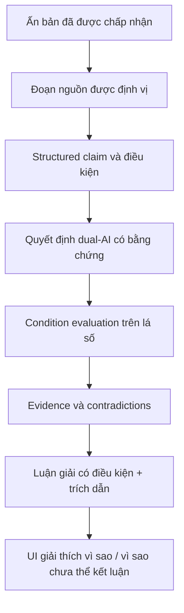
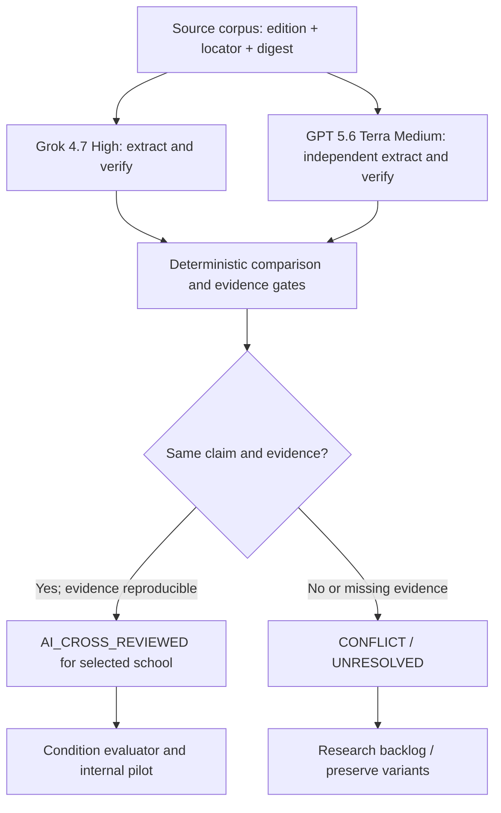

# B3 Tử Vi — Roadmap sau Sprint 8 (Sprint 9–14)

> **Loại tài liệu:** Roadmap đề xuất cho giai đoạn phát triển tiếp theo  
> **Phiên bản:** 1.1 · **Ngày lập:** 2026-10-12  
> **Trạng thái:** `PROPOSED` — chưa đồng nghĩa đã được chấp nhận theo policy dual-AI khi áp dụng triển khai  
> **Đường dẫn dự kiến trong repo:** `docs/ROADMAP_SPRINT_9_14.md`  
> **Mốc thực hiện:** Sprint 9 → 14, **không ấn định ngày kết thúc** hoặc cam kết phát hành.

## 1. Mục tiêu và vị trí của tài liệu

Sau Sprint 8, trọng tâm của `b3_tuvi` chuyển từ **nền tảng phần mềm, UI và kiểm thử** sang **độ sâu tri thức Tử Vi, khả năng luận giải có điều kiện và kiểm chứng nguồn**.

Mục tiêu cuối của giai đoạn này:

1. Có Knowledge Base gồm những luận điểm được liên kết với nguồn, ấn bản, trường phái và điều kiện áp dụng.
2. Phân biệt rõ **khớp rule trong code**, **thành/phá cách theo nguồn**, **công thức đã đối chiếu** và **luận điểm được phép sử dụng**.
3. Luận giải các cung/chủ đề **chỉ trong phạm vi claim được chấp nhận theo chính sách dual-AI và vượt qua runtime eligibility**, có thể giải thích tại sao nhận định xuất hiện hoặc bị từ chối.
4. Xây dựng các chu kỳ vận hạn theo công thức đã duyệt, không tự điền kết quả khi chưa có căn cứ.
5. Đánh giá AI như lớp diễn đạt/tra cứu evidence, không phải máy tự tính sao hoặc tự phát minh quy tắc.
6. Phát hành theo **năng lực (capability)**, không buộc mọi chức năng cùng GO chỉ vì đạt Sprint 14.

**Tài liệu này bổ sung, không thay thế**:

- [`AUTODEV_MASTER_PLAN_V2.md`](./AUTODEV_MASTER_PLAN_V2.md) — nguồn điều phối task và trạng thái chính.
- [`CONTRIBUTING.md`](./CONTRIBUTING.md) và [`AGENT_ENGINEERING.md`](./AGENT_ENGINEERING.md) — quy tắc triển khai/review/phê duyệt.
- [`knowledge/provenance-contract.json`](./knowledge/provenance-contract.json) — contract 4 chiều provenance.
- [`KNOWLEDGE_CLAIM_MODEL.md`](./KNOWLEDGE_CLAIM_MODEL.md) và [`TEST_FIXTURES.md`](./TEST_FIXTURES.md) — cấu trúc claims và phân loại test evidence.
- [`audits/RELEASE_READINESS.md`](./audits/RELEASE_READINESS.md) và báo cáo cuối Sprint 8 — bằng chứng nghiệm thu kỹ thuật.

Giữ `docs/AUTODEV_MASTER_PLAN.md` (V1) như tài liệu lịch sử. Không tạo Master Plan V3 chỉ vì có thêm roadmap.

### Điều kiện đầu vào

Sprint 8 cần có baseline kỹ thuật đã review: API trust boundaries, quyền riêng tư, CI, unit/integration/E2E, coverage và các chức năng UX liên quan. Nếu Sprint 8 chỉ `PARTIAL`, vẫn có thể thực hiện **nghiên cứu nguồn và thiết kế độc lập**, nhưng không được vượt qua gate kỹ thuật còn thiếu.

Tử Vi là hệ thống diễn giải truyền thống, không phải phương pháp dự báo đã được khoa học xác thực. Luận điểm cần có nguồn, bối cảnh, điều kiện và giới hạn; tránh khẳng định tuyệt đối về sức khỏe, sinh tử, tai họa hay số phận.

## 2. Baseline tham chiếu (phải đo lại lúc kickoff)

Đây là ảnh chụp dựa trên V2 Sprint 1–7 và audit, **không phải chỉ số live sau Sprint 8**.

| Hạng mục | Mốc tham chiếu | Ý nghĩa |
|---|---:|---|
| Catalog cách cục | 63 | Số mục trong catalog, không phải 63 công thức đã xác minh |
| Rule v2 | 58 | Số rule runtime, không phải 58 rule được chuyên gia duyệt |
| Pilot đã đối chiếu | 10/63 | 7 `CONFLICT`, 2 `PARTIAL`, 1 `NOT_IMPLEMENTED`, 0 `MATCH` |
| Chưa đối chiếu pilot | 53/63 | Backlog nghiên cứu |
| `formulaCheckedAgainstSource` | 0 | Chưa có promotion xác minh công thức trong matrix |
| Claim được duyệt cho luận giải | 0 | Chưa đủ căn cứ cho lời luận chuyên gia public |
| Structured interpretation | 12 cung chức + lớp Thân | Đã có phân tích kỹ thuật, chưa đồng nghĩa có lời luận |
| Vận hạn | Đọc nhãn Đại hạn có sẵn | Các chu kỳ khác đang blocked/not applied |
| AI | Internal POC | Chưa có đánh giá model thật hoặc public narration |

**Khi bắt đầu Sprint 9:** tái kiểm kê HEAD và số liệu thực tế. Không sao chép các con số cũ để báo tiến độ mới.

## 3. Nguyên tắc chiến lược

### 3.1. Làm sâu trước, làm rộng sau

**Ưu tiên một “vertical slice” luận giải nội bộ có nguồn và được dual-AI chấp nhận theo policy** trước khi chạy theo số lượng 63 cách cục hoặc cố tạo văn bản đủ 12 cung.

Một vertical slice được coi là thực chất khi đi hết chuỗi:



Một claim chưa đủ bằng chứng phải trả `insufficient_evidence` / `unknown` / `not_implemented` tương ứng, không tự sinh lời luận cho đủ nội dung.

### 3.2. Quy tắc xác thực ấn bản (quyết định của chủ dự án)

**`edition.authenticated === true` là đủ để vượt qua edition authentication gate.**

Không thêm điều kiện chặn từ `originalEditionAuthenticated`, `textCollatedAgainstOriginal` hoặc `authenticationScope`. Các trường này có thể được giữ để mô tả bối cảnh nhưng không phải authentication gate bổ sung.

Tuy nhiên, ba việc sau **không tự động xảy ra** chỉ vì edition được chấp nhận:

- Công thức cụ thể đã được đối chiếu đúng.
- Claim đã thỏa điều kiện trên lá số cụ thể.
- Lời luận đã đạt release gate riêng để hiển thị cho người dùng.

Tiếp tục quản lý riêng 4 lớp: `implementationStatus`, `formulaStatus`, `bibliographicStatus`, `interpretationStatus`. Unit test PASS không nâng các lớp này.

### 3.3. Delegated AI review & owner-controlled release gates

Chủ dự án là software developer ở mức nhập môn về Tử Vi; **không lấy việc chủ dự án tự đọc và xác nhận đúng sai từng đoạn sách làm dependency**. Chủ dự án ủy quyền việc **nghiên cứu, so sánh nguồn và đưa ra quyết định nghiệp vụ trong phạm vi nguồn** cho quy trình **hai model kiểm chứng chéo** ở Sprint 9:

- **Model A — Grok 4.7 High:** nghiên cứu, trích xuất claim, đề xuất trường phái, công thức, điều kiện, bằng chứng.
- **Model B — GPT 5.6 Terra Medium:** đọc nguồn **độc lập**, tái trích xuất và phản biện công thức, phạm vi, trường phái và điểm bỏ sót; không được chỉ đọc kết luận A rồi đồng ý.
- Tên model và mức effort là cấu hình Cursor do chủ dự án chỉ định. Mỗi lần chạy phải ghi nhận **model/version thực sự được Cursor sử dụng**; nếu model không khả dụng, báo rõ, không âm thầm thay model và không tuyên bố đã dual-review.
- Orchestrator phải so sánh hai kết quả bằng rule/validator xác định được; hai model **không cùng là một bằng chứng độc lập về mặt sử học** dù có hai câu trả lời giống nhau.

| Việc cần quyết định | Cơ chế áp dụng |
|---|---|
| Tìm sách, edition, sửa URL sai, gắn trường phái | Dual-AI source research; ghi URL, edition, bản số hoặc catalog, mức truy cập, bằng chứng |
| Xác thực một edition mới | Dual-AI có thể đề xuất và chấp nhận `authenticated: true` **theo chính sách ủy quyền này** nếu cả hai xác nhận đúng đối tượng/edition đã đọc hoặc đúng record đang duyệt, có locator/hash/metadata kiểm lại được; không tuyên bố đã đọc văn bản nếu chỉ có phiếu thư viện |
| Công thức/cách cục/claim **khớp đoạn nguồn** | Hai model đối chiếu độc lập cùng tài liệu, cùng vị trí đoạn; xác định `MATCH`, `PARTIAL`, `CONFLICT`, `NOT_IMPLEMENTED` và trường phái cụ thể; chỉ ghi `AI_CROSS_REVIEWED` sau khi đủ chứng cứ |
| Hai model bất đồng hoặc đoạn sách không kiểm lại được | `CONFLICT` / `UNRESOLVED` / `SOURCE_INACCESSIBLE`, nêu rõ hai phía và lý do; không tự chọn theo số phiếu, danh tiếng model hoặc diễn đạt thuyết phục |
| Bật claim trong **internal interpretation pilot** | Chỉ khi đồng thuận và kiểm tra điều kiện chạy được, validator PASS, source có locator; gắn `reviewMethod: dual_ai`, `expertVerified: false`; feature flag mặc định private/research |
| Sửa `tuviRules.mjs`, `rulesV2.json`, thay mặc định trường phái hoặc bật `disabled` | AI có thể **quyết định đề xuất nghiệp vụ**, sinh diff và regression tests; thay đổi runtime chỉ qua PR tách biệt được owner duyệt trên khía cạnh kỹ thuật, phạm vi và rollback, không âm thầm sửa/lặng lẽ merge |
| Phát hành lời luận cho người dùng, Fortune hoặc AI public | Owner quyết định **bật phát hành sản phẩm** sau khi xem audit/eval/release checklist; không cần tự đóng vai chuyên gia sách, không được ghi `expert_verified` nếu chỉ có AI |
| Knowledge SQLite production migration hoặc deploy | Owner approval riêng; phải có backup/restore, dry run và rollback |

**Giữ nguyên 4 lớp provenance chính thức** (`implementationStatus`, `formulaStatus`, `bibliographicStatus`, `interpretationStatus`). Thêm decision metadata riêng như `reviewMethod`, `reviewers`, `sourceLocator`, `sourceDigest`, `crossReviewOutcome`, `expertVerified: false`, `decisionPolicyVersion`; **không tạo một giá trị provenance mới ngoài contract chỉ để ghi dual-AI**.

**`edition.authenticated === true` vẫn là edition authentication gate duy nhất.** Cả hai model đồng ý là lý do ra quyết định theo policy, **không biến công thức thành đúng theo mọi phái** và không phải xác thực khoa học. Công thức và lời luận vẫn cần so khớp đúng đoạn, đủ điều kiện và gắn trường phái. Model agreement **không được gọi là expert review, historical authenticity hay scientific truth**.

Nếu hai model không thể truy cập cùng nguồn ở mức đủ kiểm chứng, dừng claim ở mức nghiên cứu. Dữ liệu thiếu nguồn không được bù bằng kiến thức nhớ trong model.

Không nằm trong phạm vi khi chưa có quyết định sản phẩm mới: tài khoản, lịch sử lưu ngày giờ sinh, cloud sync, subscriptions/payments. Không ghi đè `backend/data/*.sqlite`, không tự lấy mô tả catalog hoặc nội dung SQLite chưa review làm lời luận đã xác thực.

## 4. Tổng quan Sprint 9–14

| Sprint | Trọng tâm | Giá trị đạt được | Dependency chính | Mức phát hành dự kiến |
|---|---|---|---|---|
| **9** | Knowledge Base và vertical slice đầu tiên | Claim có nguồn, điều kiện và quyết định dual-AI truy vết được | Baseline Sprint 8, source corpus và dual-model access | Research/internal; public prose có gate |
| **10** | Rule Accuracy & Condition Engine | Đánh giá thành/phá cách và các điều kiện có chứng cứ | Claim/điều kiện được dual-AI kiểm chứng ở Sprint 9 | Sửa rule runtime cần PR + owner merge gate |
| **11** | Real Interpretation Engine | Luận giải có điều kiện theo các claim dual-AI accepted và runtime-valid | Sprint 9–10 | Public interpretation có gate |
| **12** | Fortune Intelligence | Time overlay/các vận được xác minh theo từng công thức | Nguồn và công thức vận hạn qua dual-AI + approval khi đổi runtime | Không dự báo chu kỳ chưa duyệt |
| **13** | Grounded AI & Q&A | AI giải thích evidence; đánh giá model thật nội bộ | Dữ liệu interpretation đủ điều kiện theo policy dual-AI | AI public cần owner release gate riêng |
| **14** | Capability-based Release | Đóng gói, kiểm thử, phát hành những phần đủ điều kiện | Sprint 8 Ops + năng lực đủ gate | Có thể phát hành từng phần |

**Cho phép chạy song song có kiểm soát:** nghiên cứu Sprint 9 khi đang đóng Sprint 8; nghiên cứu công thức vận hạn Sprint 12 song song với AI infrastructure Sprint 13 sau khi contracts ổn định. Không bắt buộc hoàn thành toàn bộ Fortune Engine rồi mới thử AI nội bộ cho các claim nguyên cục đã được dual-AI chấp nhận.

---

## 5. Sprint 9 — Multi-school Source Research & Dual-AI Knowledge Validation

**Trạng thái 9B đo ngày 2026-10-13:** research record 63/63. Span Tân Biên đọc được 24/63. PDF từng trang chưa mở lại trong batch này (0/63). Dual-AI đã ghi 24/63. Công thức `MATCH` 3, `PARTIAL` 6, `CONFLICT` 3, `NOT_IMPLEMENTED` 2. 39 cách còn `SOURCE_INACCESSIBLE` vì các sách kia không có toàn văn trong repo. Trạng thái: `RESEARCH_COMPLETE_WITH_GAPS`. Chi tiết ở `docs/knowledge/SPRINT_9B_COMPLETION_REPORT.md`. Không sửa `rulesV2.json`.

**Sprint 9C (chưa đóng Sprint 9):** 39/39 ứng viên có dual-AI riêng dưới `docs/knowledge/research/sprint-9c/`. Số lần chạy model không phải danh tính đã kiểm. Ba `NAME_MISMATCH`: Hùng Tú Triều Viên, Bán Không Chiết Xỉ, Lưỡng Trùng Thiên Mã. Các quyết định 9C còn lại là `UNRESOLVED_IDENTITY`. 24 quyết định Tân Biên không bị ghi đè. Báo cáo: `docs/knowledge/SPRINT_9C_SOURCE_DISCOVERY_REPORT.md`. Trạng thái: `RESEARCH_PARTIAL_EVIDENCE_GAPS`.

**Mục tiêu:** Xây quy trình **hai model kiểm chứng chéo** giúp chủ dự án không phải là chuyên gia Tử Vi vẫn nghiên cứu được sách, phân loại trường phái, đối chiếu công thức và tạo claim có căn cứ; sau đó chứng minh **một vertical slice** từ đoạn sách đến phân tích có điều kiện trong internal/research mode.

**Kết quả chấp nhận theo policy là `AI_CROSS_REVIEWED`, không phải `EXPERT_VERIFIED` hoặc sự thật khoa học.** Hai model có thể cùng sai; chỉ chấp nhận những gì người khác có thể truy ngược và tự kiểm lại trên tài liệu.

### 5.1. Phạm vi trường phái và nguồn

Chọn **Tam Hợp Việt Nam (`vn-tam-hop-default`) làm baseline của Sprint 9**, không coi Tam Hợp là trường phái đúng duy nhất. Phân tích và lưu riêng ít nhất ba lớp dị bản:

1. **Calculation variant:** khác cách an sao, giờ Tý, tháng nhuận, Tứ Hóa, chủ Mệnh/Thân... có thể đổi lá số.
2. **Rule variant:** cùng lá số nhưng khác điều kiện nhận diện cách cục, thành/phá cách.
3. **Interpretation variant:** cùng cấu trúc nhưng khác cách giải nghĩa, gia giảm, tổng hợp.

Ưu tiên tư liệu theo **vai trò nghiên cứu**, không giả định một sách đúng cho mọi phái:

| Nhóm nguồn | Vai trò Sprint 9 | Hạn chế |
|---|---|---|
| *Tử Vi Đẩu Số Tân Biên* — Thái Thứ Lang | **Baseline văn bản làm việc**, PDF 277 trang đã được project owner chấp nhận | Không đồng nhất PDF dựng lại với bản in gốc; so khớp đúng trang và nội dung |
| *Tử Vi Hàm Số*, *Tử Vi Tổng Hợp* — Nguyễn Phát Lộc | Nguồn so sánh luận giải và tương tác các yếu tố **khi lấy được đúng sách** | Không dùng trang giới thiệu/đường dẫn sai làm đoạn sách |
| *Tử Vi Nghiệm Lý* — Thiên Lương | Nguồn đối chiếu cách nghiệm lý Việt Nam **khi tiếp cận được văn bản** | Không mặc định hoàn toàn trùng baseline Tam Hợp |
| *Tử Vi Đẩu Số Toàn Thư* và bản Hán xác định được edition | Đối chiếu cách cục/truyền thống theo đúng bản | Không dùng truyền thuyết tác giả như chứng minh văn bản |
| Trung Châu / Vương Đình Chi | Chuẩn bị source dossier và school profile độc lập | Không trộn biến thể an sao/luận giải vào default |
| Phi Tinh / Tứ Hóa | Lập research backlog và ranh giới calculation/interpretation | Chưa thêm công thức mới vào engine mặc định |

Chỉ sử dụng nguồn có quyền truy cập hợp pháp. Lưu locator, phiên bản và trích dẫn ngắn cần thiết; không đưa nguyên văn sách có bản quyền vào repo nếu không có quyền phân phối.

**Source hygiene bắt buộc:** đối chiếu mọi URL với tên sách thực tế. Repo từng có `nguyen-phat-loc-ham-so` trỏ tới *Tân Biên* và `thien-luong-nghiem-ly` trỏ tới một đầu sách khác; sửa registry bằng chứng, không suy luận từ slug.

### 5.2. Work packages

| ID | Ưu tiên | Công việc | Bằng chứng nghiệm thu |
|---|---|---|---|
| `S09-01` | P0 | Kiểm kê HEAD, 63 combinations, 58 v2 rules, 10 pilot, 53 chưa đối chiếu, source registry và meanings | Report tự tái tạo, số đo từ code hiện tại; không gọi catalog count là verification |
| `S09-02` | P0 | Source acquisition & hygiene: đúng sách/edition, URL, file hash, trang/mục, quyền sử dụng | Dossier, 404/wrong-title report, edition locator, metadata phân biệt file số/phiếu thư viện |
| `S09-03` | P0 | School taxonomy: Tam Hợp Việt Nam baseline và registry biến thể Calculation/Rule/Interpretation | School ID và variant ID ổn định; không trộn trường phái khi tính toán |
| `S09-04` | P0 | **Dual-AI independent research:** Grok 4.7 High và GPT 5.6 Terra Medium đọc/đánh giá nguồn riêng | Có hai structured verdicts, chứng cứ riêng, model/config/prompt/version và không bị contamination |
| `S09-05` | P0 | Cross-review decision engine: so kết luận, phát hiện agreement/disagreement, fail-closed khi thiếu nguồn | Verdict `AI_ACCEPTED`, `CONFLICT`, `UNRESOLVED`, `SOURCE_INACCESSIBLE` có lý do; không ép đồng thuận |
| `S09-06` | P0 | Extract structured claims/conditions theo school & variant, map nguồn và contradictions | Claim có `sourceId`, `editionId`, locator, conditions, scope; validator + negative tests |
| `S09-07` | P0 | **Internal vertical slice:** một nhóm chính tinh/cung/cách cục có bằng chứng nguồn, qua two-model consensus | Source → AI decisions → conditions → evidence → internal structured interpretation → tests |
| `S09-08` | P0 | AI Decision Registry và reproducible review fixtures; dùng policy delegation thay human textual review | Bản ghi 2 quyết định, cùng source hash, conflicts, provenance, policy version; không tự ghi `expert_verified` |
| `S09-09` | P1 | Đối chiếu pilot 10 cách và mở rộng 53 cách **theo batch có chứng cứ**, thêm nguồn về sao/cung | Coverage matrix theo trường phái và trạng thái, không ép toàn bộ thành MATCH |
| `S09-10` | P1 | Test harness chống bịa nguồn, sai trang, sai school, khác edition, model unavailable, conflicting verdict | Independent/negative fixtures, diff report, high branch coverage cho decision gates |

### 5.3. Dual-model workflow: hai lần đọc độc lập, một lần quyết định



**Bước 1 — Khóa bằng chứng:** chọn đúng sách/edition và trích đúng đoạn, ghi locator (trang/mục, URL/file digest). Nếu văn bản không truy cập/không xác định được, `SOURCE_INACCESSIBLE` thay vì đoán từ kiến thức mô hình.

**Bước 2 — Hai model làm việc độc lập:** cung cấp cùng nguồn và schema output; phiên làm việc riêng, model B **không nhận đáp án A trước khi tự ghi và khóa verdict**. Mỗi model trả `sourceClaim`, `formulaInterpretation`, `conditions`, `exceptions`, `schoolId`, `variantType`, `sourceLocator`, `quotationOrParaphrase`, `verdict`, `uncertainties`.

**Bước 3 — So sánh theo tiêu chí:** đối chiếu tự động trích đoạn với văn bản lưu trữ (span/locator thật), kiểm nguồn có tồn tại, đúng edition, nội dung, điều kiện, giới hạn, school; nếu nguồn là bản scan không trích được văn bản chắc chắn thì lưu giới hạn hoặc kiểm lại ảnh trang, không giả định OCR đúng. Một kết luận thuận tai nhưng không có đoạn chứng minh **không được chấp nhận**. Kiểm `MATCH/PARTIAL/CONFLICT/NOT_IMPLEMENTED` trên claim/rule **cụ thể**, không tính theo tỷ lệ đồng thuận chung.

**Bước 4 — Nếu bất đồng:** cho hai model đọc bằng chứng phản biện của nhau **sau** khi đã ghi verdict đầu, tối đa một lượt phản biện có cấu trúc. Nếu vẫn bất đồng hoặc không đủ bằng chứng, `UNRESOLVED`; giữ cả hai quan điểm và không kích hoạt thay đổi hành vi runtime. Không tự thêm model thứ ba hay đổi model khi chưa được cấu hình.

**Bước 5 — Nếu đồng thuận:** ghi `AI_CROSS_REVIEWED`/`AI_ACCEPTED` trong decision registry, nguồn/edition/locator/school/revision và đối chiếu validator/tests. Tạo claim/variant trong **research KB**; chỉ cho internal pilot dùng khi điều kiện áp dụng thực sự đánh giá được. Không giả mạo một cá nhân là người duyệt sách.

**Bước 6 — Runtime release:** các công thức mặc định và file `tuviRules.mjs`, `rulesV2.json` được sửa (nếu cần) **bằng PR riêng** với evidence, decision registry, negative/regression tests và quyết định merge của owner về code/release. Việc phê chuẩn sách đã ủy quyền cho AI; owner không cần kiểm nội dung học thuật, nhưng phải thấy rõ scope và tác động để chấp thuận phát hành.

### 5.4. AI Decision Registry (schema logic minh họa)

```json
{
  "decisionId": "example-dual-ai-only",
  "policyVersion": "dual-ai-source-review-v1",
  "subjectType": "claim",
  "subjectId": "example-claim",
  "schoolId": "vn-tam-hop-default",
  "variantType": "rule",
  "sourceId": "thai-thu-lang-tan-bien",
  "editionId": "tan-bien-retypeset-277-cover-1956",
  "locator": "section/page verified from selected edition",
  "sourceDigest": "actual-digest-at-runtime-not-a-placeholder",
  "reviewers": [
    {"model": "Grok 4.7", "effort": "High", "verdict": "MATCH", "reviewRef": "independent-review-a"},
    {"model": "GPT 5.6 Terra", "effort": "Medium", "verdict": "MATCH", "reviewRef": "independent-review-b"}
  ],
  "decision": "AI_ACCEPTED",
  "reviewMethod": "dual_ai_independent_then_cross_review",
  "expertVerified": false,
  "runtimeRuleChangeApplied": false,
  "notes": "EXAMPLE ONLY: never ingest as a verified decision"
}
```

Đây là định dạng **ví dụ**, không phải lệnh ghi đè schema contract hiện hữu. Không đưa sample placeholder vào dữ liệu thật. Nếu số model/version/corpus không thể xác minh trong Cursor, lưu trạng thái `REVIEW_NOT_EXECUTED` thay vì giả mạo kết quả.

### 5.5. Definition of Done

- Đã thực thi được hai model được chọn trên **ít nhất một bộ đoạn nguồn thật**; log đầy đủ model, prompt version, artifact, locator, verdict, comparison và test.
- Có ít nhất **một internal vertical slice `AI_CROSS_REVIEWED`**, không yêu cầu chủ dự án tự giám định sách hoặc chuyên gia tự ký xác nhận. `expertVerified` vẫn false.
- Claim được áp dụng chỉ khi school đúng, mọi điều kiện bắt buộc thỏa, không có breaking chưa xét được coi như đã clear; không biến source citation thành runtime proof.
- Có negative tests: chỉ một model đồng ý, hai model cùng bịa cùng một trích dẫn, sai edition, mất file nguồn, phần trích thiếu điều kiện, ngoại lệ bị bỏ qua, model không khả dụng.
- Bất đồng được lưu lại, **không auto-resolve**; coverage báo số được cross-reviewed/partial/unresolved, không chỉ tổng số claim.
- Không đổi ngầm `rulesV2.json`, không ghi SQLite production, không tự mở public interpretation, Fortune hay AI.

**Không yêu cầu:** ép toàn bộ 63 cách thành MATCH hoặc đòi chủ dự án trở thành người thẩm định Tử Vi. Cho phép task nghiên cứu về Trung Châu/Phi Tinh tạm `DEFERRED` nếu chưa tiếp cận được đúng tài liệu.

---

## 6. Sprint 10 — Rule Accuracy, Formation/Breaking & Condition DSL

**Mục tiêu:** Chuyển “phát hiện tổ hợp sao” thành hệ thống đánh giá điều kiện có giải thích, dựa trên tri thức đã qua dual-AI cross-review theo trường phái; xử lý sai lệch theo từng rule thay vì viết thêm `if/else` tự phát.

| ID | Ưu tiên | Công việc | Bằng chứng nghiệm thu |
|---|---|---|---|
| `S10-01` | P0 | Kiểm kê operators runtime và những conditions KB chưa biểu diễn được | Operator matrix: supported/unsupported/ambiguous/by school |
| `S10-02` | P0 | Condition evaluator/DSL có kiểu dữ liệu và evidence cho operators đã định nghĩa | Trạng thái `satisfied`, `not_satisfied`, `unknown`, `not_implemented` xác định |
| `S10-03` | P0 | Độc lập `runtimeMatchStatus`, `formationConditions` và `breakingConditions` | Tests chống suy ra thành cách chỉ từ matching |
| `S10-04` | P0 | Phân tích 7 CONFLICT, 2 PARTIAL, 1 NOT_IMPLEMENTED pilot; sau đó đối chiếu catalog theo batch | Từng đề xuất có diff, nguồn, school variant, phản ví dụ, expected output |
| `S10-05` | P1 | Áp dụng rule corrections **AI_CROSS_REVIEWED** theo PR riêng, có owner merge gate | Hai independent model verdicts + source evidence + regression/negative tests + owner merge |
| `S10-06` | P1 | Contradiction resolver và nguyên tắc ưu tiên/không thể ưu tiên | Không tự chọn một trường phái hay kết luận là đúng tuyệt đối |
| `S10-07` | P1 | Tests cho rule operators, overlap, exclusions, false-positive/false-negative | Coverage theo branches và fixture độc lập khi có thể |

**Ranh giới thiết kế:** chỉ triển khai operators có semantic contract rõ ràng: đồng cung, tam hợp, xung chiếu, giáp cung, hiện diện/vắng sao, độ sáng, điều kiện Tuần/Triệt/Tứ Hóa đã có nguồn... Nếu điều kiện văn bản chưa được hỗ trợ thì `unknown/not_implemented`, không coi là đạt.

**Definition of Done:** có trace cho điều kiện đã kiểm và chưa kiểm; mọi thay đổi công thức runtime có dual-AI record, PR và quyết định merge riêng; không bật disabled rule khi thiếu quyết định; các trường hợp tranh luận được giữ trong issue/research backlog.

---

## 7. Sprint 11 — Conditional Interpretation Engine & 12 Palaces

**Mục tiêu:** Biến dữ liệu kỹ thuật của 12 cung thành **luận giải thực sự có căn cứ** cho những phần có nguồn/claim được dual-AI chấp nhận theo đúng trường phái và vượt qua eligibility. Không xây lại hệ thống lá số hiện có.

| ID | Ưu tiên | Công việc | Bằng chứng nghiệm thu |
|---|---|---|---|
| `S11-01` | P0 | Eligibility contract chỉ dùng claim `AI_CROSS_REVIEWED` được phép và thỏa mọi điều kiện | Fail closed khi thiếu nguồn, thiếu điều kiện hoặc school mismatch |
| `S11-02` | P0 | Luồng đầy đủ cho Mệnh, Thân, Phúc Đức, Quan Lộc, Tài Bạch khi có claim đủ điều kiện | Chart → rule → evidence → AI-accepted claim → trích dẫn |
| `S11-03` | P0 | Deterministic synthesis / template có điều kiện, trường phái và giới hạn | Same input/same output; không bịa lời luận hoặc nguồn |
| `S11-04` | P0 | Evidence UX: người dùng xem vì sao có/không có nhận định | Condition, breaking, alternatives, contradictions hiển thị rõ |
| `S11-05` | P1 | Mở rộng phân tích đến 12 cung chức; Thân vẫn là overlay | Regression về vị trí Thân, quan hệ giữa các cung |
| `S11-06` | P1 | Tổng hợp chủ đề bản thân, công việc, tài chính, gia đình, hôn nhân, quan hệ, tài sản, sức khỏe | Không làm mất contradictions và uncertainty |
| `S11-07` | P1 | Bộ ca được dual-AI đối chiếu nguồn, kèm verdicts và provenance | Phân biệt rõ AI-cross-reviewed với expert-verified và synthetic/regression fixtures |
| `S11-08` | P1 | Accessibility/copy/export đối với phần interpretation được phép | Không in/xuất lời luận chưa approved |

### Nguyên tắc câu chữ

- Mỗi statement có claim ID, nguồn, điều kiện áp dụng, trường phái, evidence và limitations.
- Ưu tiên “theo trường phái/nguồn X, khi điều kiện Y thì thường được luận...” thay cho kết luận chắc chắn.
- Không tự tạo hệ số tốt/xấu hoặc life score. Nếu chưa có rubric được duyệt, giữ `score: null`.
- Không dùng ý nghĩa sao/cung trong SQLite chưa review làm lời luận xác thực.
- Đề cập sức khỏe dưới góc nhìn truyền thống, không thay chẩn đoán y khoa hay dự đoán sinh tử.

**Definition of Done:** một số cung/chủ đề dual-AI accepted có thể trả lời đầy đủ bằng ngôn ngữ tự nhiên *kèm căn cứ*; mọi phần còn thiếu trả trạng thái thiếu evidence cụ thể. Việc public những lời luận vẫn yêu cầu owner release approval riêng, kể cả khi code đã xong.

---

## 8. Sprint 12 — Fortune Intelligence (Formula-gated)

**Mục tiêu:** Xây phần vận hạn theo chu kỳ, nhưng chỉ tính toán và luận những phần công thức/điều kiện đã qua dual-AI source review cùng owner merge/release gate.

| ID | Ưu tiên | Công việc | Bằng chứng nghiệm thu |
|---|---|---|---|
| `S12-01` | P0 | Research dossier Đại hạn, Tiểu hạn, lưu niên, lưu tinh, Tứ Hóa hạn và trường phái | Công thức, điều kiện, biến thể, nguồn, unresolved issues |
| `S12-02` | P0 | Time DTO: natal vs time overlay, tuổi/năm, Can Chi, boundary, timezone, lineage | Hợp đồng rõ ràng + boundary fixtures |
| `S12-03` | P0 | Kiểm tra lại việc hiển thị nhãn Đại hạn đã có | Phân biệt nhãn nguyên cục và phép tính vận mới |
| `S12-04` | P1 | Implement từng phép tính có **AI_CROSS_REVIEWED** trong module riêng qua PR | Hai model verdicts + independent examples + regression tests + owner merge |
| `S12-05` | P1 | Nối time overlay với claims/evidence và nguyên cục | Không suy luận khi thiếu nguồn hoặc điều kiện |
| `S12-06` | P1 | Boundary tests: năm, tuổi, âm/dương nam nữ, tháng nhuận, trường phái | Kết quả lặp lại được; trường hợp không biết phải trả unknown |
| `S12-07` | P1 | UI vận hạn thể hiện `supported/blocked/not_applied` và nguồn | Không hiển thị dự báo chưa duyệt |

**Definition of Done:** chu kỳ nào được bật thì phải có công thức được dual-AI cross-reviewed, trường hợp kiểm thử độc lập, nguồn truy vết và điều kiện rõ. Chu kỳ thiếu nguồn tiếp tục `blocked/not_applied`. Nếu thiếu nguồn hoặc hai model bất đồng, ghi `UNRESOLVED`/`BLOCKED_SOURCE`; nếu thay đổi runtime chưa qua PR/owner merge gate, ghi `BLOCKED_RELEASE`. Không yêu cầu chủ dự án tự thẩm định văn bản Tử Vi.

---

## 9. Sprint 13 — Grounded AI Narration & Q&A

**Mục tiêu:** Thử nghiệm AI giúp người dùng hiểu dữ liệu được chấp nhận theo policy dual-AI, **không cho LLM tự an sao, tự xác nhận công thức, tự đặt nguồn hay tự dự đoán**.

| ID | Ưu tiên | Công việc | Bằng chứng nghiệm thu |
|---|---|---|---|
| `S13-01` | P0 | Provider abstraction, secret/config, timeout, output schema, token/cost limit | Mock tests + integration contract |
| `S13-02` | P0 | Grounded Narrator lấy **AI-reviewed eligible interpretation claims** làm đầu vào | Statement ↔ claim ↔ conditions ↔ evidence được kiểm tra |
| `S13-03` | P0 | Semantic grounding guard (không chỉ check ID có tồn tại) | Adversarial tests phát hiện câu hợp ID nhưng sai ngữ cảnh |
| `S13-04` | P0 | Q&A theo DTO do server tính; chặn forged client analysis và prompt injection | Trust-boundary and abuse tests |
| `S13-05` | P0 | Đánh giá model thật trong môi trường nội bộ khi có provider/dữ liệu được phép | Báo cáo factuality, hallucination, abstention, cost, latency |
| `S13-06` | P1 | Privacy/data-flow review trước khi gửi chart/evidence sang provider | Mục đích, dữ liệu tối thiểu, lưu trữ phía provider và quyết định phê duyệt |
| `S13-07` | P1 | Prompt/evaluation versioning, regression suite và lấy mẫu kiểm chứng chéo có truy vết | So sánh giữa prompt/model versions có căn cứ; không đòi owner tự đánh giá đúng-sai Tử Vi |
| `S13-08` | P1 | Feature-flagged beta và rollback cho AI | Release gate public được duyệt riêng |

### AI evaluation gates

Bắt buộc đánh giá theo: unsupported statements, hallucinated sources, sai gán nguồn, ngữ cảnh mâu thuẫn, khả năng từ chối khi thiếu dữ liệu, an toàn với câu hỏi nhạy cảm, prompt injection, chi phí và độ trễ. Báo số mẫu và điều kiện test; **mock PASS không phải real-model evaluation**.

Khi chưa qua gate public: **giữ lời model ở `text: null` / withheld** và tiếp tục deterministic fallback. Không tự bật AI public chỉ vì Sprint 13 đã phát triển xong.

---

## 10. Sprint 14 — Capability-based Release & Operations

**Mục tiêu:** Triển khai sản phẩm theo từng năng lực đủ điều kiện, thay vì gắn một nhãn “production-ready” cho cả hệ thống.

| ID | Ưu tiên | Công việc | Bằng chứng nghiệm thu |
|---|---|---|---|
| `S14-01` | P0 | Rà P0/P1, coverage, CI và regression từ Sprint 8 | Không còn blocking findings trong phạm vi phát hành |
| `S14-02` | P0 | Feature flags theo capability: chart, evidence, dual-AI accepted interpretation, fortune, AI | Default fail-closed và rollback tests |
| `S14-03` | P0 | Security/privacy: input, log, abuse, rate limit, dependency, dữ liệu sinh | Threat model, negative tests, không giữ birth history ngầm |
| `S14-04` | P0 | Deploy/staging/recovery/rollback, backup cho migration được duyệt | Rehearsal có thể lặp lại và khôi phục |
| `S14-05` | P1 | Browser E2E, accessibility, responsive, print/export | CI E2E + manual spot-check evidence |
| `S14-06` | P1 | Observability an toàn: health, error metrics, log tối thiểu | Không lộ ngày giờ sinh/request payload |
| `S14-07` | P1 | Release matrix và thông báo giới hạn sản phẩm | GO / CONDITIONAL GO / NO-GO riêng cho từng năng lực |
| `S14-08` | P1 | Post-release triage, regression monitoring, research backlog | Không tự sửa công thức hay nâng provenance sau sự cố |

### Release gates độc lập

| Capability | Gate kỹ thuật | Gate nghiệp vụ/human |
|---|---|---|
| Lập/xuất lá số | API, privacy, CI/E2E, hiệu năng và rollback | Công khai giới hạn nguồn và không tuyên bố dự báo khoa học |
| Nhận diện cách cục & Evidence Explorer | Matcher, evidence, disabled rule guard và tests | Nói rõ đây là **pattern detection**, không tự gọi luận giải xác thực |
| Luận giải các chủ đề/cung | Eligibility, condition evaluation, citation trace và trust boundary | Claim dual-AI accepted; public release cần owner quyết định |
| Vận hạn | Tests theo thời gian, boundary, formula lineage | Công thức từng chu kỳ dual-AI accepted và owner chấp nhận merge/release |
| AI Narration & Q&A | Semantic guard, live eval, privacy, monitoring | Owner quyết định bật public AI, chỉ dùng nội dung phù hợp |
| Knowledge production migration | Migration dry run, backup và restore | Phê duyệt bằng quyết định riêng; không overwrite SQLite |

Có thể GO cho **chart/research mode**, trong khi **expert interpretation, fortune prediction và AI** vẫn NO-GO.

---

## 11. Engineering Quality & Test Strategy xuyên suốt

Sprint 8 đặt nền test coverage. Sprint 9–14 phải **duy trì và tăng độ tin cậy**, không đánh đổi correctness để đạt tỷ lệ đẹp.

- Ghi nhận line/statement/branch/changed-code coverage từ report thực; không ước lượng.
- Đối với code mới hoặc thay đổi, **mục tiêu** ≥95% line và ≥90% branch nếu khả thi; các decision paths về provenance, eligibility, condition evaluation và trust boundary phải có positive/negative tests đầy đủ.
- Không hạ coverage thresholds, thêm exclusions tùy tiện, skip tests hoặc mock chính function cần test.
- Test cả error paths, edge cases, deterministic behavior, immutability, data loss, race conditions, backwards compatibility và browser E2E.
- Dùng property/metamorphic tests hoặc mutation testing có chọn lọc cho pure functions quan trọng.
- Expected outputs độc lập khi có thể; **không copy thuật toán production thành oracle** rồi kết luận công thức đúng.
- Tách `synthetic`, `regression`, `independently_verified`, `expert_verified` fixtures. Không gọi fixture tự tạo là golden chuyên gia.
- Review logic lặp, dead code, source of truth mâu thuẫn và scope creep; không chạy review/fix loop vô hạn.
- Không tự động merge các thay đổi công thức domain khi chưa có record dual-AI và owner quyết định merge/release.

### Definition of Done cho mỗi task

1. Dependency và approval gates được ghi rõ.
2. Có deliverable thực tế, tests hoặc bằng chứng nghiên cứu có thể kiểm tra.
3. API compatibility, privacy và security được đánh giá.
4. Diff tập trung, không format/refactor file ngoài phạm vi.
5. CI PASS; coverage đo được; remaining gaps được mô tả.
6. Trạng thái công thức, nguồn và claim không bị nâng sai; mọi promotion có decision record dual-AI theo policy.
7. Documentation và backlog được cập nhật.
8. Có PR cho owner review kỹ thuật/release; không tự merge/deploy.

Ưu tiên PR nhỏ theo nhóm: nguồn/claims; validator/DSL; rule correction dual-AI accepted; interpretation; fortune; AI safety/evaluation; operations. Tránh gộp nghiên cứu nguồn, sửa công thức và refactor rộng trong cùng PR.

## 12. KPIs & Progress Reporting

| Nhóm | Đo cái gì | Không được đồng nhất với |
|---|---|---|
| Source coverage | Claim có trích dẫn định vị, nguồn/ấn bản, trường phái | Công thức đã đúng |
| Formula coverage | Đã so nguồn, MATCH/PARTIAL/CONFLICT và quyết định duyệt | Test implementation PASS |
| Interpretation coverage | Claim dual-AI accepted **và thỏa điều kiện** theo cung/chủ đề | Số đoạn văn hiển thị |
| Rule quality | False positives/negatives, operator branch coverage, known exceptions | Tổng số rules |
| Fortune coverage | Chu kỳ đã hỗ trợ/blocked và số ca đối chiếu độc lập | Chỉ có nhãn Đại hạn |
| AI evaluation | Tỷ lệ assertion không hỗ trợ, sai nguồn, abstention, số mẫu, cost/latency | ID citation hợp lệ đơn thuần |
| Engineering | Coverage thật, CI stability, E2E, P0/P1, performance | Kết luận nghiệp vụ được xác minh |
| UX | Evidence dễ hiểu, accessibility, empty/error states | Chỉ có UI render được |

Cuối mỗi sprint cần báo cáo: baseline/final HEAD, PR/commit, completed/blocked tasks, số liệu coverage, kết quả CI, evidence/approval records, source gaps, technical debt và các task READY tiếp theo.

### Decision Registry — nguyên tắc lưu bằng chứng

Sprint 9 định nghĩa dual-AI registry mẫu tại §5.4. Mọi quyết định nguồn/claim/formula cần lưu:

- `decisionId`, subject ID, `sourceId`, `editionId`, school/variant scope, locator, digest.
- Hai verdicts độc lập từ **Grok 4.7 High** và **GPT 5.6 Terra Medium**, thực tế model/version/config, prompt version, evidence refs và kết quả so sánh.
- `reviewMethod: dual_ai_independent_then_cross_review`, `expertVerified: false`, `crossReviewOutcome`, unresolved points và revision.
- Review tài liệu và quyết định **triển khai/release** là hai cổng khác nhau: owner không phải đọc sách, nhưng vẫn duyệt merge, migration, public AI và triển khai production.

Không bịa model invocation, trích dẫn, digest hoặc người duyệt. Nếu hai model không được gọi thật, trạng thái là `REVIEW_NOT_EXECUTED`.

## 13. Rủi ro và biện pháp kiểm soát

| Rủi ro | Biện pháp |
|---|---|
| Có rất nhiều dữ liệu nhưng vẫn không luận giải được | Ưu tiên vertical slice dual-AI reviewed ở Sprint 9 |
| Nhầm edition authenticated với công thức đúng | Giữ công thức và interpretation approval độc lập |
| AI/code tự sửa rule để khớp nguồn | Hai verdicts + evidence + PR + owner merge gate + regression |
| Nguồn/trường phái mâu thuẫn nhưng chỉ chọn một kết luận | Giữ school ID, contradiction evidence và uncertainty |
| AI viết trôi chảy nhưng bịa căn cứ | AI-accepted-claim-only, semantic guard, abstention, live eval |
| Coverage rất cao nhưng nghiệp vụ sai | Tách software tests khỏi source/expert verification |
| Vận hạn được triển khai theo phỏng đoán | Giữ chu kỳ chưa có công thức ở blocked/not_applied |
| Ngày giờ sinh bị ghi log/lưu ngầm | Stateless API, log tối thiểu, privacy review |
| Code phình to vì các lần review/refactor | PR nhỏ, xóa trùng có chứng cứ, không refactor ngoài scope |
| Migration làm hỏng SQLite hiện có | Human approval + temp dry run + backup/restore/rollback |

## 14. Checklist khởi động Sprint 9

- [ ] Có Sprint 8 Final Report và kết quả coverage/CI/E2E thực tế.
- [ ] Xác nhận `origin/main` mới nhất; remediation quan trọng đã merge hoặc có lý do hoãn.
- [ ] Đếm lại catalog, rules, nguồn, pilot claims và approval statuses từ code hiện tại.
- [ ] Chọn một chủ đề/cách cục pilot **có đoạn nguồn truy vết được**; kiểm tra Grok 4.7 High và GPT 5.6 Terra Medium chạy được độc lập, lưu model/version chính xác.
- [ ] Áp dụng policy dual-AI: AI_CROSS_REVIEWED chỉ là chấp nhận theo nguồn/trường phái, không tự đồng nghĩa expert/public; owner giữ quyết định bật phát hành.
- [ ] Tách task Sprint 9 từ `S09-*`, có scope, dependencies, reviewer và acceptance tests.

**Việc nên làm đầu tiên:** `S09-01` + `S09-02` (kiểm kê và source mapping), tiếp đến `S09-04`/`S09-05` (dual-AI validation) rồi `S09-07` (một internal vertical slice). Đây là cách nhanh nhất để chứng minh engine có thể đưa ra **một nhận định có căn cứ trong hệ thống Tử Vi đang dùng**, trước khi mở rộng hàng loạt.

### Các phần tiếp tục chưa được tự triển khai/public

- Account, lịch sử lá số, cloud sync, billing/payment (`EXCLUDED_BY_PRODUCT_SCOPE`).
- Public expert-style prose từ descriptions/catalog hoặc SQLite meanings chưa được review.
- Sửa công thức an sao/vận hạn chưa có dual-AI source decisions và owner merge gate; mở cách cục disabled hoặc public AI ngoài release gate.
- Knowledge production migration (`V2-KB-03-prod` vẫn `BLOCKED_HUMAN`).

---

**Quyết định mới áp dụng:** chủ dự án đã ủy quyền kiểm tra nguồn/claim theo dual-AI cho Sprint 9; những human domain-review dependencies trái với chính sách này cần cập nhật đồng bộ trong task plan/engineering guidelines khi triển khai, nhưng không sửa Master Plan V1 và không bỏ owner release gate.

**Quy tắc bảo trì:** cập nhật roadmap bằng PR tập trung khi thứ tự phụ thuộc, nguồn hoặc quyết định miền thay đổi. Trạng thái task chính vẫn theo Master Plan V2 hoặc tracker chính thức. Tài liệu này là **kế hoạch sau Sprint 8**, không phải bằng chứng Sprint 9–14 đã bắt đầu hoặc hoàn tất.
