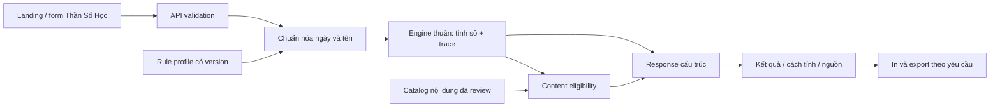

# Roadmap Thần Số Học từ A–Z

> **Roadmap:** v2.1 · **Cập nhật:** 2026-10-14 · **Baseline xác nhận:** `main` `2d08b2e` (PR #20–#24, **#31** knowledge expansion — công thức 5 chỉ số nâng cao).
> **Runtime:** profile `pythagorean-vn-v1` `1.2.0`, editorial catalog `1.2.0` (102 core/chu kỳ + 44 đỉnh + 8 thử thách = 154 bài), lớp nhãn `arrow-labels-vn-v1`.
> **Scope:** `V1_FEATURE_COMPLETE` cho calculator + chaptered visual report; **chưa** `FORMULA_SOURCE_VERIFIED`, `RELEASE_GATES_PASSED` hoặc `PRODUCTION_READY`.
> **CI:** Backend/frontend/e2e PASS tại [main run 38438302551](https://github.com/hptbee/b3_tuvi/actions/runs/38438302551). Không suy từ CI thành staging.
> **Theo dõi:** trạng thái NUM task tại §12.9, checklist §15, roadmap tiếp theo §18.

Đây là **living roadmap**. Các đặc tả công thức, ví dụ và cây file mang chữ *dự kiến* là lịch sử thiết kế; mã runtime và [FORMULA_SPEC](../numerology/FORMULA_SPEC.md) là nguồn chi tiết của profile đang chạy. Chỉ đánh dấu complete theo đúng chiều: calculation, visualization, interpretation, source verification, release.

**Không ấn định ngày phát hành.** Mọi mốc mới dựa vào dependency và evidence gate.

## 1. Cách sử dụng roadmap

Đây là kế hoạch mới cho **Thần Số Học**, không thay thế [roadmap Tử Vi Sprint 9–14](ROADMAP_SPRINT_9_14.md), [Master Plan V2](AUTODEV_MASTER_PLAN_V2.md), [Contributing](../engineering/CONTRIBUTING.md) hoặc [Agent Engineering](../engineering/AGENT_ENGINEERING.md).

Khi triển khai:

1. Kiểm kê HEAD, những gì đã có, CI và thay đổi của người dùng.
2. Hoàn thành quyết định domain tại §4; ghi thành rule profile có version.
3. Chọn các task sẵn sàng theo dependency ở §12; không bắt đầu từ việc viết lời luận.
4. Mỗi task có mã `NUM-*`, output, test và tiêu chí hoàn thành.
5. Khi hoàn thành, gắn commit/report thực tế vào checklist; không đánh dấu bằng việc chỉ tạo file rỗng hoặc script chưa chạy.
6. API, file và command có ghi **dự kiến** chưa tồn tại cho đến khi task tương ứng được triển khai.

Các công thức trong tài liệu là **baseline đề xuất để review**, không tuyên bố là quy tắc duy nhất của mọi trường phái, không tự tạo cờ `authenticated`, `expert_verified` hoặc `approved` cho nguồn/nội dung.

## 2. Mục tiêu sản phẩm và ranh giới

### 2.1. Trải nghiệm đích

Người dùng từ landing page chọn Thần Số Học, nhập ngày sinh dương lịch và họ tên nếu muốn, rồi nhận:

- Các chỉ số từ ngày sinh; chỉ số từ họ tên nếu đủ dữ liệu.
- Mỗi kết quả có cách tính, quy tắc đang dùng và giới hạn.
- Nội dung ngắn, dễ đọc, có nguồn/trạng thái review; có thể mở phần giải thích chi tiết.
- Biểu đồ ngày sinh trực quan, không cần hiểu thuật ngữ trước.
- In/tải kết quả theo lựa chọn của người dùng; không cần đăng nhập.
- Kết quả mới luôn đi cùng input đã gửi, không bị request cũ ghi đè.

Thần Số Học giữ phong cách riêng, dự kiến tím/kem; dùng chung logo, menu trên cùng, accessibility và các primitive form/button với Tử Vi. Không dựng dashboard quản trị cho trải nghiệm công khai.

### 2.2. Các lớp năng lực và trạng thái

| Lớp | Năng lực | Trạng thái tại `ed31ad1` |
|---|---|---|
| N1–N3 | 7 chỉ số, validation, trace, API, UX | **DONE** theo profile 1.2.0 |
| N4 / P0a / P1 | Birth Grid 8 tuyến, biểu đồ tên/ghép, kim tự tháp, challenge age track, dải 9 năm + 12 tháng, dashboard/báo cáo nhiều chương | **DONE** cho scope đã chốt |
| N4 / P0b | 154 bài biên tập theo metric/giai đoạn, tên tuyến tách khỏi công thức | **PARTIAL CONTENT**: số 33, Challenge 0 và lớp luận sâu còn withheld |
| N5 | JSON export/import có server recalculation, A4 print, in-process limiter, CI, local probe | **DEV COMPLETE / RELEASE OPEN** |
| Source | Đối chiếu định nghĩa sách và chuyên gia | **NOT VERIFIED**: Decoz chỉ `source_read`, không sách |
| N6 | Hidden Passion, Karmic Lessons, Balance, Rational Thought, Bridge (+ synthesis, alt profiles, AI) | **FORMULA DONE / PR #31** cho 5 chỉ số (API + UI trace, **interpretation withheld**); synthesis/alt profile/AI vẫn **PLANNED** |
| Production | Live staging/proxy/rollback/approval | **NOT READY** |

### 2.3. Ngoài phạm vi

Không đưa đăng ký, đăng nhập, hồ sơ, lịch sử sinh, đồng bộ cloud, thanh toán hoặc dashboard vào backlog dưới tên khác. Không thêm chức năng tương hợp cặp đôi, luận tên em bé hoặc dự báo sức khỏe/tài chính như điều kiện hoàn thành V1.

Không dùng LLM để tính số, suy chữ nguyên âm hoặc quyết định trường phái. Không gom Tử Vi và Thần Số Học thành một “điểm số cuộc đời”. Không giới thiệu các kết quả như phương pháp khoa học đã được xác nhận.

## 3. Baseline và nguyên tắc kiến trúc

### 3.1. Trạng thái runtime hiện hành

| Hạng mục | Trạng thái tại `main 2d08b2e` |
|---|---|
| Landing/form | `/than-so-hoc`: ngày sinh, tên tùy chọn, ngày xem, validate, async snapshot |
| Engine | `backend/src/numerology/`: 7 metrics, grids, cycles, pinnacles/challenges, **`indicators` (5 advanced)**, trace |
| API | GET `/api/numerology/profiles`, GET `/api/numerology/meanings/:metricId/:value`, POST `/api/numerology/calculate` |
| Content | Catalog `1.2.0` có 154 bài đã qua review AI độc lập; số 33 và Challenge 0 withheld |
| UI | Báo cáo nhiều chương, overview, lưới ngày sinh và tên/ghép, tháp đỉnh, age track, 9 năm/12 tháng |
| Tải/in | Export JSON, import tính lại trên server, in A4; opt-in họ tên, không tự lưu lịch sử |
| Privacy | `no-store`, safe logging, limiter theo process, không thêm persistence |
| Tests | CI backend/frontend/e2e trên main sau #31 PASS; chưa live staging |
| Sources | Hồ sơ quy ước sản phẩm, 5 trang Decoz đọc được; chưa `edition_verified`/expert signoff |

**Mốc lịch sử:** `8fc5a01` là preview (engine/API chưa có), không còn là baseline để giao task. Xem [IMPLEMENTATION_STATUS](../numerology/IMPLEMENTATION_STATUS.md) và [COMPLETION_MATRIX](../numerology/implementation/COMPLETION_MATRIX.md).

### 3.2. Kiến trúc đích



- Engine không phụ thuộc Express, SQLite, browser, network hoặc clock ngầm.
- Backend là nguồn tính toán; frontend không copy bảng chữ cái/công thức.
- Chia sẻ layout/form/date primitives khi có lợi; engine và dữ liệu domain vẫn riêng.
- Không thay đổi engine Tử Vi, bảng sao hoặc schema hiện tại chỉ để thêm lĩnh vực mới.
- Nội dung JSON được load read-only; kết quả người dùng không lưu server mặc định.
- Runtime có thể dùng helper chung sau khi có test chứng minh tương đương; tránh ép mọi domain vào một schema khổng lồ.

## 4. Quyết định domain của profile đang chạy

### 4.1. Decision register D01–D12 (đã chọn cho profile 1.2.0, chưa được chứng nhận từ sách)

| ID | Quyết định | Quy ước đang triển khai | Giới hạn/đối chiếu nguồn |
|---|---|---|---|
| `D01` | Trường phái | Hệ Pythagorean, profile riêng cho sản phẩm tiếng Việt | Source dossier, phân biệt biến thể từ các sách/tác giả |
| `D02` | Số đặc biệt | Bộ `{11,22,33}` cho một số chỉ số, không áp toàn cục | Matrix theo từng metric; đặc biệt 33 và tuổi đỉnh cao |
| `D03` | Cách tính Đường đời | Tổng tất cả chữ số của ngày/tháng/năm, rồi reduce | So sánh với cách reduce từng thành phần; không trộn hai cách |
| `D04` | Tên sử dụng | Họ tên khai sinh do người dùng nhập; tên thường dùng là tính năng khác | Copy form và nguồn công thức tên |
| `D05` | Tên tiếng Việt | NFD, bỏ dấu kết hợp, `Đ → D`, Latin A–Z | Fixture Unicode; không tự nhận mọi hệ chữ đã hỗ trợ |
| `D06` | Chữ Y | Baseline kỹ thuật: Y là phụ âm | Review ảnh hưởng tên Việt; công bố rõ trước khi submit |
| `D07` | Chu kỳ cá nhân | Năm dương lịch, bắt đầu 01/01; không đổi ở sinh nhật | Nguồn/variant riêng nếu chọn birthday-based |
| `D08` | Ngày sinh / tuổi | Date-only Gregorian, không cần giờ/giới tính | Leap day, timezone và mốc tuổi |
| `D09` | Thiếu tên | Vẫn tính nhóm ngày sinh; nhóm tên unavailable | API/UI phải phân biệt unavailable với giá trị 0 |
| `D10` | Đỉnh cao / thử thách | Công thức đề xuất tại §5.6; giảm Đường đời về 1–9 để tính tuổi | Review các mốc inclusive/exclusive bằng timeline |
| `D11` | Nội dung | Catalog có nguồn + review độc lập với engine | Không suy “số đã tính đúng” thành “lời luận đúng” |
| `D12` | Riêng tư | POST, không lưu sinh/tên mặc định, không query-share tên đầy đủ | Review export, logs, analytics và trình duyệt |

**Definition of Ready:** có profile, spec của từng metric, các quyết định đã ghi nhận, fixtures tính độc lập và trạng thái nguồn. Nếu chưa chốt một metric mở rộng, tiếp tục phần đã đủ điều kiện; không tạo kết quả placeholder giống số thật.

### 4.2. Rule profile — ví dụ policy snapshot (không phải API contract)

```json
{
  "profileId": "pythagorean-vn-v1",
  "profileVersion": "1.2.0",
  "status": "experimental",
  "lifePathMethod": "all-date-digits",
  "masterNumbers": [11, 22, 33],
  "masterPolicy": "per-metric",
  "namePolicy": "latin-vn-nfd-v1",
  "yPolicy": "consonant",
  "personalYearBoundary": "calendar-year",
  "birthDatePolicy": "gregorian-date-only",
  "nonLeapBirthday": "march-1",
  "sourceReferences": []
}
```

`sourceReferences: []` biểu thị chưa có dossier được gắn, không phải cấu hình đủ gate để gọi nguồn đã duyệt. Không nhận profile JSON tùy ý từ client. Client chỉ chọn ID/version có trong allowlist server.

Đổi cách tính, mapping tên, Y hoặc lịch chu kỳ là thay đổi profile semantics: tăng version, cập nhật expected fixtures và release note. Hai kết quả khác version không được so như cùng công thức.

## 5. Đặc tả công thức — quy ước sản phẩm (không phải chuẩn chung)

Đang chạy profile 1.2.0. Đặc tả đầy đủ nằm tại [FORMULA_SPEC](../numerology/FORMULA_SPEC.md), khác Decoz tại life path all-digits, rút master của thành phần đỉnh, Y và cách cộng tên. Không sửa giá trị 1.2.0 để khớp nguồn khác.

### 5.1. Hàm nền và reduction

Định nghĩa `digitSum(n)` cho số nguyên không âm, và `reduce(n, keepMasters)`:

1. Kiểm tra integer hữu hạn, không âm; lỗi input không bị ép thành 0.
2. Nếu metric cho phép 0, trả 0 khi `n=0`; nếu không, dùng lỗi domain/unavailable.
3. Tại mỗi bước, nếu `n` thuộc `{11,22,33}` và `keepMasters=true`, dừng.
4. Nếu `n<10`, dừng; còn lại thay bằng tổng chữ số và lặp.
5. Trả cả kết quả và mọi bước, không chỉ value.

Ví dụ: `reduce(29,true) → 29 → 11`; `reduce(29,false) → 29 → 11 → 2`; `reduce(33,true) → 33`; `reduce(33,false) → 33 → 6`.

Hàm không nhận phép tính dạng chuỗi để `eval`. Trace do engine dựng từ bước tính thật. `rootValue` luôn giảm về 1–9 cho chỉ số dương; trường hợp master giữ cả `value`, `rootValue`, `isMaster`.

| Metric | Giữ 11/22/33? | Ghi chú |
|---|---|---|
| Đường đời | Có | Tổng toàn bộ chữ số ngày sinh rồi reduce |
| Ngày sinh | Có | Reduce số ngày; chỉ có thể gặp 11/22, ngày 33 không tồn tại |
| Thái độ | Không | Tổng chữ số ngày + tháng |
| Sứ mệnh / Biểu đạt | Có | Tổng chữ cái họ tên |
| Linh hồn | Có | Tổng nguyên âm theo policy |
| Nhân cách | Có | Tổng phụ âm theo policy |
| Trưởng thành | Có | Tổng value Đường đời + Biểu đạt theo profile này |
| Năm/tháng/ngày cá nhân | Không | Giảm về 1–9 |
| Đỉnh cao | Có | Reduce tổng thành phần được quy định ở §5.6 |
| Thử thách | Không | Giá trị 0–8 từ hiệu tuyệt đối |

Một hàm reduction chung không đồng nghĩa mọi metric có cùng `keepMasters`. Không ép metric sinh ra 33 nếu công thức/miền đầu vào không thể tạo nó.

### 5.2. Chỉ số từ ngày sinh — MVP

Input: `{ year, month, day }` là **ngày Gregorian thật**.

- **Đường đời (`lifePath`)**: `reduce(digitSum(day)+digitSum(month)+digitSum(year), true)`.
- **Ngày sinh (`birthday`)**: `reduce(day, true)`; giữ `originalDay` riêng để giải thích, ví dụ 29 → 11.
- **Thái độ (`attitude`)**: `reduce(digitSum(day)+digitSum(month), false)`.

Không dùng `new Date('YYYY-MM-DD')` rồi lấy giờ địa phương để suy ngày. Validate round-trip các trường date-only, đúng năm nhuận thế kỷ; có thể dùng helper UTC với test hoặc helper lịch thuần. Không chuyển âm lịch, không cần `hour`, `gender`.

Baseline input range: năm `1200`–`2199`, tương thích giới hạn kỹ thuật hiện có; ngày sinh sau `referenceDate` trả lỗi. Giới hạn này là quyết định sản phẩm, không phải giới hạn phép cộng số. Birth date chỉ gồm integer JSON; không dùng `parseInt('15abc')` để chấp nhận input bẩn.

### 5.3. Chuẩn hóa tên tiếng Việt — MVP

Pipeline phải công bố trong phần “Cách tính”:

1. Trim, chuẩn hóa NFC để kiểm tra độ dài **1–100 Unicode code points** khi có tên; phân biệt omitted/blank với sai kiểu.
2. Từ chối control/zero-width characters và ký tự chưa hỗ trợ; không xóa âm thầm để làm đẹp input.
3. Chuyển NFD, bỏ combining marks, đổi `Đ/đ` thành `D`, uppercase.
4. Cho phép A–Z, khoảng trắng, dấu gạch nối `-`, nháy đơn `'` và `’`; chuẩn hóa các separator được hỗ trợ về khoảng trắng đơn. Những separator không tính giá trị.
5. Tokenize nhưng giữ mapping sang chữ gốc cho UI; cộng **mọi chữ cái**, không tự đổi thứ tự họ/tên hoặc bỏ tên đệm.
6. Tên không còn chữ cái sau normalization là lỗi; thiếu tên thì nhóm chỉ số tên trả unavailable.
7. `Æ`, `Ø`, emoji, số, Hán tự và chữ ngoài mapping không tự được transliterate. Báo lỗi dễ hiểu, gợi ý người dùng nhập tên Latin phù hợp; không yêu cầu engine đoán tên.

Độ dài phải được giới hạn cả trước và sau normalization; không tạo chuỗi lớn trong trace. Họ tên hiện là optional, không tự lấy từ form Tử Vi hoặc đồng bộ theo cookie.

Bảng Pythagorean đề xuất:

| Giá trị | Chữ cái |
|---:|---|
| 1 | A, J, S |
| 2 | B, K, T |
| 3 | C, L, U |
| 4 | D, M, V |
| 5 | E, N, W |
| 6 | F, O, X |
| 7 | G, P, Y |
| 8 | H, Q, Z |
| 9 | I, R |

Định nghĩa nguyên âm của baseline: **A, E, I, O, U**. Y luôn là phụ âm trong profile v1 đề xuất; đây là lựa chọn rõ ràng để review, không phải khẳng định đúng cho mọi tên Việt. Nếu sau này có variant Y theo phát âm, phải có policy riêng, fixtures và UI giải thích; không dựa vào một regex hoặc LLM ẩn.

### 5.4. Chỉ số từ tên và Trưởng thành — MVP

- **Biểu đạt/Sứ mệnh (`expression`)**: reduce tổng tất cả giá trị chữ cái, giữ masters.
- **Linh hồn (`soulUrge`)**: reduce tổng nguyên âm, giữ masters.
- **Nhân cách (`personality`)**: reduce tổng phụ âm, giữ masters.
- **Trưởng thành (`maturity`)**: reduce `lifePath.value + expression.value`, giữ masters; chỉ khi cả hai có dữ liệu.

Không có nguyên âm hoặc không có phụ âm thì metric tương ứng trả `status: "unavailable"`, reason `no_vowels`/`no_consonants`, value null. Không đưa 0 vào catalog 1–9 và bịa ý nghĩa.

Kiểm tra bất biến trước reduction: `vowelTotal + consonantTotal === expressionTotal`. Đây là kiểm tra mapping, không xác minh nội dung diễn giải.

### 5.5. Biểu đồ ngày sinh và các tuyến số — V1

Đếm **các chữ số 1–9 trong ngày sinh**, bỏ 0; không thêm Đường đời, số tên hoặc chữ số do engine suy ra. Giữ dữ liệu gốc trước reduction.

```text
3 | 6 | 9
2 | 5 | 8
1 | 4 | 7
```

- Mỗi ô có số lần xuất hiện, ví dụ `1 × 2`; ô vắng ghi “không xuất hiện trong ngày sinh”, không gọi đó là thiếu năng lực.
- Trả `counts` đủ key 1–9, `presentDigits`, `missingDigits`, `ignoredZeroCount` và `layoutVersion`.
- Tám tuyến đề xuất: `{1,2,3}`, `{4,5,6}`, `{7,8,9}`, `{1,4,7}`, `{2,5,8}`, `{3,6,9}`, `{1,5,9}`, `{3,5,7}`.
- `present` chỉ khi cả ba số xuất hiện; `absent` khi cả ba vắng; còn lại `partial`. Số lặp không thay đổi điều kiện tồn tại.
- Engine chỉ nhận diện; tên gọi và ý nghĩa “mũi tên” là dữ liệu có nguồn, review riêng. Không suy từ tên tuyến thành kết luận tâm lý.

Biểu đồ tên hoặc biểu đồ kết hợp ngày sinh/tên là backlog riêng, không trộn vào `birthGrid`.

### 5.6. Đỉnh cao và Thử thách — V1, sau review công thức

Đặt `M=reduce(month,false)`, `D=reduce(day,false)`, `Y=reduce(year,false)`; giữ trace từng thành phần.

**Đỉnh cao đề xuất:**

- `P1 = reduce(M+D,true)`.
- `P2 = reduce(D+Y,true)`.
- `P3 = reduce(P1.value+P2.value,true)`.
- `P4 = reduce(M+Y,true)`.

**Thử thách đề xuất:**

- `C1 = abs(M-D)`.
- `C2 = abs(D-Y)`.
- `C3 = abs(C1-C2)`.
- `C4 = abs(M-Y)`.

Giá trị 0 của Thử thách là hợp lệ theo profile này; không dùng điều kiện truthy để bỏ nó. Kết quả 0 không được diễn giải là “không có thử thách”.

**Các giai đoạn tuổi đề xuất:**

- `E = 36 - lifePath.rootValue`; dùng root 1–9 kể cả lifePath 11/22/33.
- P1/C1: tuổi `[0,E]` inclusive.
- P2/C2: tuổi `[E+1,E+9]` inclusive.
- P3/C3: tuổi `[E+10,E+18]` inclusive.
- P4/C4: từ tuổi `E+19` trở đi.

Không tính tuổi bằng `targetYear-birthYear` khi chưa qua sinh nhật. Tuổi là số sinh nhật đã hoàn thành tại `referenceDate`. Sinh 29/02 dùng 01/03 cho ngày kỷ niệm trong năm không nhuận theo baseline; chính sách này cần review và fixture. Các interval API có `startAgeInclusive`, `endAgeInclusive` (null cho giai đoạn cuối) và các mốc date-only tương ứng.

Đây là **một phương án đặc tả để review**, nhất là mốc tuổi và cách giảm số master. Nếu nguồn được chọn khác, sửa profile/spec và fixture trước runtime, không âm thầm sửa đáp án test.

### 5.7. Chu kỳ cá nhân — V1

Input có `targetDate` dạng `YYYY-MM-DD`; dùng cùng helper Gregorian, không cần timestamp.

- `personalYear = reduce(digitSum(birth.day)+digitSum(birth.month)+digitSum(target.year), false)`.
- `personalMonth = reduce(personalYear.value+digitSum(target.month), false)`.
- `personalDay = reduce(personalMonth.value+digitSum(target.day), false)`.

Baseline là **năm dương lịch 01/01–31/12**. Không thay đổi vào sinh nhật. Dòng UI phải có năm/ngày đang xem, không ghi “năm hiện tại” khi user chọn năm khác.

Nếu client không gửi `targetDate`, API chụp một `referenceDate` theo `Asia/Ho_Chi_Minh`, trả lại trong response và truyền xuống engine. Không để engine gọi clock. Cho phép targetDate từ ngày sinh đến hết 2199; ngày đích trước sinh trả lỗi. Không tự ghi nhận ngày xem thành dữ liệu lịch sử.

## 6. Fixtures độc lập và ví dụ kiểm tra tay

**Đã có fixture và CI cho profile hiện tại.** Ví dụ đối chiếu: Nguyễn Văn An, 15/06/1990 → Đường đời 4, Biểu đạt 3, Nhân cách 11, đỉnh 3/7/1/7, thử thách 0/5/5/5. Chỉ số mới phải có fixture tính độc lập trước khi code.

Các ví dụ dưới đây xác minh phép tính theo **baseline đề xuất**, chưa xác minh trường phái hoặc lời luận. Khi spec được review, đưa vào fixture có `input`, `profileVersion`, `expected`, `derivation`, `fixtureClass` và reviewer; expected không được tạo bằng chính engine đang test.

### 6.1. Ngày 15/06/1990, tên “Nguyễn Văn An”

Ngày sinh:

```text
Tổng ngày sinh: 1+5+0+6+1+9+9+0 = 31
Đường đời: 31 → 4
Ngày sinh: 15 → 6
Thái độ: (1+5)+(0+6) = 12 → 3
```

Tên normalized: `NGUYEN VAN AN`; letters: `NGUYENVANAN`.

```text
N G U Y E N V A N A N
5 7 3 7 5 5 4 1 5 1 5
Biểu đạt: 48 → 12 → 3
Nguyên âm U,E,A,A: 3+5+1+1 = 10 → 1
Phụ âm: 38 → 11 (root 2)
Trưởng thành: 4+3 = 7
```

Biểu đồ: `1:2`, `5:1`, `6:1`, `9:2`; số còn lại 0; hai chữ số 0 được bỏ. Đỉnh cao: `M=6,D=6,Y=1 → P1=3,P2=7,P3=1,P4=7`. Thử thách: `0,5,5,5`. Giai đoạn tuổi: `[0,32]`, `[33,41]`, `[42,50]`, `[51,∞)`.

Với targetDate `2026-10-12`: năm cá nhân `(1+5)+6+(2+0+2+6)=22 → 4`; tháng cá nhân `4+1=5`; ngày cá nhân `5+(1+2)=8`. Năm cá nhân không giữ 22 theo profile này.

### 6.2. Những ví dụ phải có trong bộ fixture

| Input / phép tính | Expected theo baseline | Mục đích |
|---|---|---|
| 01/01/2000 | Đường đời 4 | Chữ số 0, đầu năm |
| 29/09/2007 | Tổng 29 → Đường đời 11/root 2 | Master xuất hiện ở bước trung gian |
| 11/09/2000 | Tổng 13 → Đường đời 4 | Phân biệt all-digits với component reduction giữ master (có thể ra 22) |
| 29/02/2020 | Tổng 17 → Đường đời 8 | Ngày nhuận hợp lệ |
| 29/02/1900 | Invalid | Gregorian thế kỷ không nhuận |
| 29/02/2000 | Valid | Thế kỷ chia hết 400 |
| `reduce(22,true)`, `reduce(33,true)` | 22, 33 | Dừng master |
| `reduce(22,false)`, `reduce(33,false)` | 4, 6 | Chu kỳ và tuổi dùng root |
| “Đỗ” | `DO`; expression 10 → 1; vowel 6; consonant 4 | Đ và dấu tiếng Việt |
| NFC/NFD của cùng họ tên | Kết quả giống nhau | Unicode normalization |
| “LY” với Y=phụ âm | Expression 10 → 1; soul unavailable; personality 10 → 1 | Không suy nguyên âm bằng phát âm |
| “AE” | Expression/soul 6; personality unavailable | Không trả 0 thay unavailable |
| Tên chỉ khoảng trắng | Nhóm tên unavailable | Input optional |
| `fullName: 123` / emoji / zero-width | 400, lỗi field rõ | Không silently drop |
| TargetDate trước sinh | Invalid | Chronology |
| Tuổi đúng ngày chuyển phase | Đúng một active phase | Không overlap/gap |

Bổ sung fixture có tổng gốc 11/22/33 và nhiều bước đạt master cho nhóm tên; fixture ngày ra Đường đời 22/33 phải được tính tay và lưu derivation. Không dùng một ca `reduce(33)` để thay cho test orchestration Đường đời 33.

## 7. Data model, nguồn và nội dung

Catalog runtime 1.2.0 đã có 154 bài (102+44+8). Các phần schema *dự kiến* dưới đây mang tính lịch sử; xem [CONTENT_POLICY](../numerology/CONTENT_POLICY.md) và [SOURCE_REGISTRY](../numerology/SOURCE_REGISTRY.md). Review AI không thay xác minh ấn bản hoặc chuyên gia.

### 7.1. Các loại dữ liệu tách riêng

| Loại | Ví dụ | Version |
|---|---|---|
| Rule profile | Reduction/name/Y/cycle policies | `profileVersion` |
| Formula spec | ID metric, input, tính toán, source locator | `formulaVersion` |
| Source registry | Edition, author, locator, quyền sử dụng | `sourceRegistryVersion` |
| Meaning catalog | Nội dung theo metric/value/profile | `contentVersion` |
| API contract | Trường dữ liệu và error codes | `schemaVersion` |
| Export | Tập dữ liệu dùng để import/đối chiếu | `exportVersion` |

Cùng một con số 4 không dùng chung một bài nghĩa cho Đường đời, Linh hồn và Năm cá nhân. Master 11 không tự lấy nghĩa số 2 mà bỏ mất trạng thái master; có thể cung cấp root context riêng nếu được review.

### 7.2. Source acquisition và review

1. Xác định nguồn phù hợp cho hệ Pythagorean và từng biến thể; không gán nhãn chính thống bằng popularity.
2. Mỗi nguồn có tên/tác giả/ấn bản, locator chính xác, fingerprint nếu có file, quyền truy cập/phân phối.
3. Trích dẫn ngắn đủ đối chiếu; không đưa nguyên cuốn sách có bản quyền vào repository.
4. Lập matrix `metric → công thức → đoạn nguồn → quyết định profile → fixture`.
5. Khi hai nguồn khác nhau, giữ cả variance và lý do chọn; không xóa conflict cho báo cáo đẹp.
6. Review công thức tách khỏi review nội dung. Áp dụng policy nguồn/approval của repository khi triển khai; roadmap này không tự thực hiện review hoặc chỉ định thêm model.
7. Chưa xác nhận được nguồn: giữ `unreviewed`/`source_unavailable`; tính toán chỉ phát hành khi spec của capability đủ gate, nội dung chưa đủ thì withheld.

Không có bibliography đã xác nhận trong roadmap này. Task đầu phải tạo dossier thực tế, thay vì copy các URL/tên sách đoán từ AI.

### 7.3. Contract nội dung dự kiến

```json
{
  "contentId": "life-path-4-v1",
  "metricId": "lifePath",
  "value": 4,
  "profileId": "pythagorean-vn-v1",
  "compatibleProfileVersions": ["1.0.0"],
  "locale": "vi-VN",
  "title": "Nội dung mẫu — chưa phát hành",
  "summary": "",
  "strengths": [],
  "reflectionPrompts": [],
  "limitations": [],
  "sourceReferences": [],
  "reviewStatus": "draft",
  "approvedForPublic": false
}
```

Eligibility tối thiểu: schema hợp lệ, metric/value/profile khớp, nội dung nonempty, nguồn đủ theo policy, review hoàn thành, `approvedForPublic=true`. File mẫu ở trên phải bị validator/public serializer từ chối như nội dung chưa đủ điều kiện.

Văn phong: gợi ý suy ngẫm, tránh định mệnh hóa; không đưa kết luận chẩn đoán sức khỏe, tuổi thọ, tài chính hoặc điều kiện “phải đổi tên để thành công”. Nội dung cho thử thách/mũi tên không gắn nhãn đạo đức với ô số vắng.

## 8. API contract — bản thiết kế lịch sử

Ba API đã có. Ví dụ MVP bên dưới chưa bao gồm `nameChart`, `combinedChart`, `cycles.yearBand`, `cycles.months`, đỉnh/thử thách và nội dung mới; [API_CONTRACT](../numerology/API_CONTRACT.md) là tài liệu hiện hành.

**Tất cả endpoint trong phần này chưa tồn tại tại baseline.** Thiết kế theo REST hiện có, route mỏng gọi service/engine.

### 8.1. Endpoints

| Method | Endpoint dự kiến | Công việc |
|---|---|---|
| `GET` | `/api/numerology/profiles` | Trả metadata profile public, mô tả policy và capability; không trả nguồn nội bộ chưa duyệt |
| `POST` | `/api/numerology/calculate` | Validate, tính chỉ số, trace và nội dung eligible |
| `GET` | `/api/numerology/meanings/:metricId/:value?profileId=` | Chỉ trả nghĩa đã đủ gate; metric/value allowlist |

Không tạo endpoint history hoặc lưu birth profile. Không dùng API meanings để vượt gate bằng URL guessed value. Nếu cần nhiều version public, thêm version selection rõ ràng; profileVersion omitted thì server chọn active version và trả version thực.

### 8.2. Request

```json
{
  "birthDate": { "year": 1990, "month": 6, "day": 15 },
  "fullName": "Nguyễn Văn An",
  "profileId": "pythagorean-vn-v1",
  "targetDate": "2026-10-12",
  "locale": "vi-VN"
}
```

- `birthDate` bắt buộc; `fullName` optional, `targetDate` optional với quy tắc default tại §5.7.
- Locale v1 chỉ `vi-VN`; không fallback thành nội dung tiếng khác không có thông báo.
- Từ chối array/scalar body, ngày sai, trường lạ quan trọng, `normalizedName`, `metrics`, `analysis`, công thức/profile tùy ý do client gửi. Tên là dữ liệu đầu vào, không phải instruction cho engine/AI.
- Không nhận `hour`/`gender` như yêu cầu ngầm. Không suy giới tính từ tên.

### 8.3. Response minh họa cho MVP tính toán

```json
{
  "ok": true,
  "schemaVersion": "1.0.0",
  "profile": { "id": "pythagorean-vn-v1", "version": "1.0.0" },
  "referenceDate": "2026-10-12",
  "contentVersion": "1.0.0",
  "metrics": {
    "lifePath": {
      "status": "available",
      "value": 4,
      "rootValue": 4,
      "isMaster": false,
      "formulaId": "life-path-all-date-digits-v1",
      "rawTotal": 31,
      "steps": [{ "input": 31, "digits": [3, 1], "output": 4 }],
      "meaning": null,
      "meaningStatus": "withheld"
    },
    "expression": {
      "status": "available",
      "value": 3,
      "rootValue": 3,
      "isMaster": false,
      "formulaId": "expression-latin-vn-v1",
      "rawTotal": 48,
      "steps": [
        { "input": 48, "digits": [4, 8], "output": 12 },
        { "input": 12, "digits": [1, 2], "output": 3 }
      ],
      "meaning": null,
      "meaningStatus": "withheld"
    }
  },
  "capabilities": {
    "core": "available",
    "birthGrid": "not_implemented",
    "cycles": "not_implemented",
    "pinnacles": "not_implemented"
  },
  "warnings": [{ "code": "Y_AS_CONSONANT", "field": "fullName" }]
}
```

Ví dụ chỉ lược trích hai metric, chưa phải response đầy đủ. Schema chính thức phải định nghĩa toàn bộ key và cấu trúc trace: missing capability khác missing input khác withheld meaning. Không trả `contentVersion` giả nếu chưa có catalog version; dùng null theo schema.

Nhóm chỉ số tên khi omitted: `status: "unavailable"`, `reason: "missing_name"`, `value: null`. Capability có sẵn nhưng input thiếu không trả `not_implemented`.

Trace normalization tên chỉ trả trong response tương ứng và giới hạn kích thước; mặc định không echo raw name vào metadata/logs. UI biết input đã gửi ở client. Không cache response chứa trace họ tên trong CDN/shared cache.

### 8.4. Errors và validation

| HTTP | Code đề xuất | Hành vi UI |
|---:|---|---|
| 400 | `INVALID_BIRTH_DATE` | Focus/đánh dấu nhóm ngày, giữ nguyên các field khác |
| 400 | `UNSUPPORTED_NAME_CHARACTER` | Nêu ký tự/nhóm ký tự không hỗ trợ ở response riêng; không log tên |
| 400 | `INVALID_TARGET_DATE` | Giữ targetDate đang sửa, gợi ý phạm vi |
| 400 | `CLIENT_RESULT_REJECTED` | Báo request không hợp lệ |
| 400 | `INVALID_JSON` | Phản hồi JSON thống nhất |
| 404 | `PROFILE_NOT_FOUND` | Cho chọn profile đang hỗ trợ |
| 404 | `MEANING_UNAVAILABLE` | Vẫn hiển thị số và cách tính |
| 413 | `PAYLOAD_TOO_LARGE` | Không tính, hướng dẫn giảm dữ liệu |
| 429 | `RATE_LIMITED` | Retry theo `Retry-After` khi có; không tự bắn loop |
| 500/503 | `CALCULATION_FAILED` / `SERVICE_UNAVAILABLE` | Thông báo gọn, retry chủ động |

Error contract: `{ ok:false, error:{ code, message, fields:[{path,code,message}] } }`. Xác định rõ JSON parser middleware hiện có trả shape khác; bổ sung compatibility theo route hoặc chuẩn hóa có test hồi quy, không vô tình đổi contract Tử Vi.

## 9. Thiết kế giao diện và UX

UI visual report đã triển khai qua PR #24 (overview, grid overlays, tháp đỉnh có cạnh, challenge track, dual-source 3×3, 9 năm/12 tháng, print). Phần mô tả *dự kiến* dưới là lịch sử thiết kế; UX tiếp theo ưu tiên nội dung sâu, progressive disclosure, print page breaks và a11y/cross-browser.

### 9.1. Routes và navigation dự kiến

- `/than-so-hoc`: landing + giải thích + form; thay preview khi capability core sẵn sàng.
- `/than-so-hoc/ket-qua`: kết quả trong session client; refresh có trạng thái nhập lại/import, không crash.
- `/than-so-hoc/phuong-phap`: profile, cách tính, chính sách Y/master/chu kỳ và nguồn public.
- `/than-so-hoc/kien-thuc`: catalog bài viết sau khi có nội dung review.

Đây là routes mới dự kiến. Chưa có persistence thì không giả định result route tồn tại chỉ nhờ URL. `Link` về Tử Vi phải giữ route/domain đúng.

### 9.2. Landing và form

- Hero ngắn, CTA đi tới form; hai domain có thể khác màu/illustration nhưng menu chung.
- MVP chỉ hỏi ngày sinh và tên optional; không hỏi giờ, nơi sinh, giới tính để tạo cảm giác cần thiết giả.
- Label rõ “Ngày sinh dương lịch”, “Họ tên khai sinh (không bắt buộc)”.
- Note normalization và Y ngay cạnh tên hoặc disclosure dễ thấy trước khi tính.
- Input text có `autocomplete=name`; ngày/tháng/năm tách rõ, numeric keyboard, có labels thật.
- Có ví dụ điền sẵn **dữ liệu mẫu** do người dùng chủ động chọn; không tự nhập dữ liệu thật từ storage cũ.
- Ngày sai, ký tự không hỗ trợ, mất kết nối có thông báo inline, không dùng alert chứa hướng dẫn developer.
- Không có tên thì CTA vẫn hoạt động; explain vì sao nhóm tên chưa có kết quả.

### 9.3. Trang kết quả

Thứ tự ưu tiên:

1. Tóm tắt Đường đời và cách nhìn kết quả, ghi profile/version.
2. Nhóm chỉ số ngày sinh và tên; trạng thái unavailable diễn đạt dễ hiểu.
3. “Cách tính” mở theo từng metric; các phép cộng/normalization đọc được bằng screen reader.
4. Biểu đồ ngày sinh V1, legend và alternative text/list; không chỉ dựa vào vị trí/màu.
5. Chu kỳ đang xem + date selector; đỉnh cao/thử thách sau khi capability tương ứng sẵn sàng.
6. Nội dung eligible, nguồn và câu hỏi suy ngẫm; thiếu nội dung thì thông báo ngắn.
7. In/export/edit input; data draft và submitted tách riêng.

Không hiển thị một lưới metric rỗng như dashboard admin. Không thêm biểu đồ/radar về “% năng lực” nếu không có metric định nghĩa và căn cứ.

### 9.4. State và concurrency

State machine: `idle → validating → loading → ready | error`. Tách input đang sửa, input đã submit và result theo request key.

- Request mới abort request trước; callback kiểm tra request ID trước cập nhật.
- Edit form không tự đổi nhãn trên kết quả cũ.
- Loading có `aria-busy`, live status, CTA chống double-submit; không chặn navigation.
- Chuyển domain không cho phản hồi cũ mở lại kết quả.
- Retry dùng đúng input đã gửi; nếu người dùng sửa form, CTA submit phải gửi input mới rõ ràng.
- Không gọi API khi chỉ mở/đóng tab nội dung đã có.

### 9.5. Accessibility, mobile, SEO

- Một H1 mỗi page; headings theo cấp, focus-visible, skip link, touch target tối thiểu 44px.
- Tab order hợp lý; disclosure/FAQ dùng native details hoặc primitive có ARIA đúng.
- Không đánh dấu tính cách chỉ bằng tím/đỏ/xanh; kiểm tra contrast nội dung/action với WCAG AA.
- Test ở 360/390, 768, 1024, 1440px; bảng/biểu đồ không gây page overflow.
- Respect reduced motion; không cần tải remote font/image để hiểu hoặc dùng form.
- Title/description riêng cho Thần Số Học; public landing được index, trang kết quả cá nhân `noindex`.
- Vite SPA chưa tự có server-rendered SEO: nếu cần prerender/SSR cho landing, mở task riêng, đo tác động và bảo vệ dữ liệu cá nhân.

## 10. Export, dữ liệu cá nhân và vận hành

Export/import JSON, A4 print, name opt-in đã triển khai. Proxy đa instance, live staging, rollback rehearsal và release approval chưa xong; limiter chỉ in-process. Xem [RELEASE_READINESS](../numerology/RELEASE_READINESS.md).

### 10.1. Lưu trữ và chia sẻ

Mặc định không có server persistence, localStorage chứa sinh/tên, background sync hoặc analytics payload chứa raw input. Tính trong request và giữ result ở memory client.

V1 chọn **download/import JSON + in**; không query-share họ tên như route Tử Vi hiện có. Browser refresh mất memory thì hiển thị lời hướng dẫn nhập lại; không tự chuyển dữ liệu sang URL để “fix refresh”.

Nếu bổ sung lưu cục bộ sau này, đó là lựa chọn explicit: xác định sessionStorage/localStorage, TTL, xóa dữ liệu, shared device và consent. Không biến nó thành history feature mặc định.

### 10.2. Export/import contract

Export có `exportVersion`, profile/version, ngày sinh, metrics/trace được phép, contentVersion, disclaimer. Họ tên chỉ bao gồm khi người dùng chọn “Kèm họ tên”; phải xem trước phạm vi dữ liệu.

Import chỉ lấy input hợp lệ, revalidate và **tính lại ở server**. Không tin chỉ số/lời luận nằm trong file; nếu profile cũ không còn hỗ trợ, báo rõ thay vì silently recalculate bằng profile mới. Limit file size, JSON schema, không render HTML từ file.

In dùng kết quả đã submit, ẩn menu/form/button, giữ profile/version và note tham khảo. Kiểm tra A4, ngắt trang cho từng block; không trộn dữ liệu đang sửa.

### 10.3. Logging, cache và observability

- Log method/path, request ID an toàn, duration, status/error code và capability version; không body, birthDate, fullName, normalizedName hoặc per-letter trace.
- Response tính toán: `Cache-Control: no-store`; cấu hình CDN/reverse proxy tương ứng.
- GET catalog public có cache versioned/ETag phù hợp; không cache lỗi/thông tin cá nhân thành catalog.
- Metrics vận hành chỉ aggregate counts/latency/error codes, không lấy label có name/date hoặc hash dễ dò ngày sinh.
- Error handler không trả stack trace/path nội bộ; kiểm tra middleware route hiện có.
- Rate limit/budget payload thực thi ở proxy/app đã chọn; tránh chỉ ghi config trong tài liệu.

### 10.4. Performance và release

Engine là phép tính nhỏ; chưa cần queue, worker pool, database/vector store hoặc cache input người dùng.

SLO đề xuất sau đo baseline: engine p95 dưới 20ms với tên tối đa, endpoint p95 dưới 200ms trên máy benchmark được ghi rõ; đây là mục tiêu kỹ thuật, chưa có số đo. Test theo resources thực tế, không dùng ngưỡng tuyệt đối gây flaky CI trên máy khác.

Frontend chia chunk theo route khi cần; không preload LLM/visualization library lớn cho form đơn giản. Health của capability xem thêm profile/catalog validation; `/api/health` Tử Vi hiện tại chưa chứng minh engine Thần Số Học ready.

Feature flag/capability gate: khi core chưa ready thì preview; khi chỉ content chưa ready thì vẫn có thể tính với `meaningStatus=withheld`. Rollback quay lại preview/profile cũ hợp lệ, không cần xóa database. Phát hành production vẫn theo quy trình review/owner của repo.

## 11. Chiến lược kiểm thử

CI tại main `ed31ad1` đã PASS backend, frontend và E2E. Đây là bằng chứng phần mềm, không thay thử nghiệm staging/cross-browser hoặc đối chiếu nguồn.

### 11.1. Unit / property tests

| Nhóm | Ca bắt buộc | Điều cần phát hiện |
|---|---|---|
| Reduction | 0, integer invalid, 1–9, 11/22/33, 29, nhiều vòng reduce | Master bị mất hoặc áp sai metric |
| Gregorian | Ngày 0/32, tháng 0/13, 29/02/1900/2000, tương lai, boundary year | Date auto-rollover hoặc timezone shift |
| Name normalization | NFC/NFD, Đ/đ, dấu, hoa/thường, whitespace, separator, unsupported/control | Mất chữ, khác kết quả Unicode, silent transliteration |
| Mapping A–Z | Toàn bộ 26 chữ với expected riêng | Bảng bị lệch một giá trị |
| Vowel/consonant | Y, tên không nguyên âm, toàn nguyên âm | Trả 0 giả hoặc sum sai |
| Metrics cốt lõi | Fixture all-digits/component khác nhau, tên, maturity, thiếu tên | Sai orchestration dù reducer đúng |
| Birth grid | Zeros, repeated digits, 9 keys, từng tuyến present/absent/partial | Bỏ count hoặc tạo số không nằm trong ngày sinh |
| Cycles | 31/12 → 01/01, selected date khác today, leap day | Ranh giới birthday/calendar bị trộn |
| Pinnacles/challenges | Master Đường đời, challenge 0, birthdays phase boundaries | Tuổi âm, overlap, gap, truthiness bug |
| Catalog | Duplicate ID, source thiếu, value/profile sai, draft/private | Nội dung lọt gate |
| Serialization | Available/unavailable/not implemented, null đúng chỗ, no HTML | Contract không ổn định |

Bất biến nên có:

- `reduce(reduce(n,policy),policy)` giữ nguyên kết quả; không nhầm proof phép tính với proof domain.
- Chỉ số cùng input/profile/referenceDate deterministic, không dùng clock hoặc random.
- `digitSum` và normalization không mutate input.
- Tên tương đương theo normalization policy cho cùng kết quả; unsupported input không được ép tương đương.
- Tổng vowel/consonant bằng expression trước reduce.
- Tổng birthGrid counts bằng số chữ số nonzero trong date representation.
- Các phase tuổi phủ kín từ 0, không overlap, đúng một active phase tại một tuổi hợp lệ.

Nếu dùng thư viện property testing mới, chỉ thêm khi có giá trị kiểm tra thật; các generated case không thay expected fixtures độc lập.

### 11.2. Integration / API tests

1. Valid date, không tên → nhóm date available, nhóm name unavailable.
2. Tên tiếng Việt → mapping/trace đúng, profile/version trả đầy đủ.
3. Sai ngày/tên/target/profile/locale/body/oversize → status/code/fields đúng.
4. Client gửi metrics/analysis/profile object giả → bị từ chối.
5. Catalog draft/source thiếu → không có lời nghĩa public; số/cách tính vẫn hiện khi capability đủ gate.
6. Profile disabled → không được gọi direct URL để bypass UI.
7. Test raw input không đi vào logs, cache headers của response là no-store.
8. Gọi calculate nhiều lần không ghi vào bảng SQLite Tử Vi; chạy bằng DB temp và kiểm tra row counts, không chạm dữ liệu người dùng.
9. Không tên, không nguyên âm, challenge 0 → reason/value đúng, không dùng falsy handling.
10. Route errors/JSON parse contract tương thích; Tử Vi regression suite vẫn đạt.

### 11.3. Component tests

- Labels/field errors, form optional-name, unsupported name hint.
- Loading, ready, error, retry, unavailable metric, withheld meaning.
- Master badge luôn đi cùng root và formula policy.
- Data draft và result tách; đổi form chưa submit không đổi kết quả.
- Trace/FAQ keyboard; birthGrid có alternative list.
- Target date selector, mốc phase, export opt-in name.
- Import validation, unsupported profile version, oversized file.

### 11.4. E2E acceptance matrix

| ID | Flow | Kết quả cần quan sát |
|---|---|---|
| `E01` | Landing → Thần Số Học → CTA → nhập ngày → kết quả | Đúng route/domain, không yêu cầu giờ/giới tính |
| `E02` | Date-only | Chỉ số date đúng fixture; nhóm tên hướng dẫn nhập thêm |
| `E03` | Tên tiếng Việt có Đ/dấu/Y | Trace normalization đúng, Y policy hiển thị |
| `E04` | Fixture master 11/22/33 | Value/root/master badge và cách tính đúng |
| `E05` | Ngày không tồn tại và sửa lại | Inline error; input còn nguyên; submit sửa thành công |
| `E06` | API 503 → retry | Không mất input, một kết quả đúng, không loop |
| `E07` | Request cũ chậm; submit/navigate request mới | Phản hồi cũ không ghi đè hoặc đổi route |
| `E08` | Edit chưa submit | Result, export và nội dung vẫn thuộc input cũ |
| `E09` | Thiếu catalog/nội dung draft | Số/cách tính hiện, không có nghĩa giả |
| `E10` | Birth grid | Counts/legend/trace đúng, không cần màu để đọc |
| `E11` | Target date đổi qua 31/12–01/01 | Chu kỳ theo selected date, trace và label khớp |
| `E12` | Đổi mốc tuổi phase | Đúng một phase active, tuổi 29/02 theo policy |
| `E13` | Export không/kèm tên + import | File đúng lựa chọn, import tính lại, không tin metrics sửa tay |
| `E14` | Keyboard + in | Tab/Enter hoạt động; print gọi đúng, không in draft input |
| `E15` | Mobile 360/390 và desktop 1024/1440 | CTA dễ tới, không overflow; navigation không giống admin sidebar |
| `E16` | Refresh result / direct result route | Empty recovery state rõ, không crash hoặc lộ input trong URL |
| `E17` | Chuyển qua Tử Vi và quay lại | Giữ các route Tử Vi hoạt động, không trộn state/domain |

MVP phải chạy E01–E09, E14–E17 theo capability có thật; E10–E13 bắt buộc khi V1 bật. Không ghi “pass” cho ca chưa triển khai hoặc test đã skip. E04 cần tất cả fixture mà công thức được review thực sự có thể tạo, không inject số giả rồi gọi là engine E2E.

### 11.5. Tích hợp runner và CI

- Backend: đăng ký file test mới vào `backend/scripts/runTests.mjs`; kiểm tra chạy **đúng file**, không chỉ `npm test` exit 0.
- Frontend: test trong `src/numerology/**/*.test.{js,jsx}` phù hợp Vitest glob hiện có.
- E2E: `frontend/e2e/numerology*.spec.js` được Playwright discover; chọn browser Chromium baseline, thêm browser khác sau nếu cần.
- Coverage backend hiện bao gồm `src/**/*.js`, `src/**/*.mjs`; không loại numerology khỏi include để giữ báo cáo xanh.
- Không giảm baseline coverage hoặc bỏ assertion chỉ để merge. Đo baseline sau khi code mới có test; gap phải được giải thích.
- Đăng ký validate catalog/profile vào job phù hợp, fail khi version/schema sai.
- Các test tính toán/import dùng data synthetic, clock cố định; API thật cho happy path, mock mạng chỉ cho lỗi/race.
- Khi mock retry ở Vite StrictMode, tạo failure phase rõ rồi recovery phase sau thao tác người dùng; không giả định chỉ có một request mount.
- Timeout/sleep chỉ dùng để mô phỏng latency có mục đích; ưu tiên gate/waitForResponse và observable condition.

Command **hiện có** từ root:

```bash
npm test --prefix backend
npm run test:ci --prefix backend
npm test --prefix frontend
npm run test:ci --prefix frontend
npm run lint --prefix frontend
npm run build --prefix frontend
```

Từ `frontend`: `npm run test:e2e`. Command `test:numerology` hoặc validate riêng nếu cần phải được tạo và chạy trước khi ghi vào README như command có thật.

## 12. Lộ trình triển khai và work packages

### 12.1. Các giai đoạn và trạng thái đã đối chiếu

| Giai đoạn | Scope | Trạng thái tại `ed31ad1` | Gate còn mở |
|---|---|---|---|
| N0 | Baseline, D01–D12, source/fixtures | ENGINEERING READY | Source book/edition vẫn OPEN |
| N1 | Seven-metric engine | DONE | Không chứng minh công thức trường phái |
| N2 | API/catalog/privacy | DONE for V1 | Content trial/verification separate |
| N3 | Public MVP & UX | DONE for V1 | Browser/WCAG depth ngoài test hiện có |
| N4 | Grids, cycles, pinnacles, meaning/report | DONE for defined visuals; PARTIAL interpretation | 33, Challenge 0, deeper synthesis |
| N5 | Export/import/print/ops | PARTIAL | Live staging, shared proxy, rollback/approval |
| N6 | New indicator/profile/content/AI | PLANNED/REQUIRES_SPEC | Evidence, formula tie/master/fixtures |

Các bảng dưới giữ **định nghĩa và acceptance ban đầu** để truy vết. Trạng thái của từng mã task nằm trong §12.9, không suy ra một task chưa làm chỉ vì bảng còn nguyên.

### 12.2. N0 — Discovery, sources và đặc tả

| Task | Ưu tiên | Deliverable | Acceptance |
|---|---|---|---|
| `NUM-001` | P0 | Baseline report: HEAD, routes, scripts, CI, dữ liệu đang có | Đo lại actual state; preview không bị ghi thành tính năng engine |
| `NUM-002` | P0 | Source registry và dossier công thức cốt lõi | Locator truy được, quyền sử dụng, conflict matrix; không invented bibliography |
| `NUM-003` | P0 | Decision register D01–D12 + profile v1 | Mỗi policy có rationale/nguồn/trạng thái; per-metric masters rõ |
| `NUM-004` | P0 | Formula spec và fixture handbook | Tính tay ít nhất một ca mỗi nhánh khó; all-digits/component divergence |
| `NUM-005` | P0 | API schema/error contract/UX wireflow | Null/status semantics, privacy/export decisions; không yêu cầu thêm input không cần |

**G0:** không có ambiguity làm đổi kết quả trong scope MVP. Những tranh luận chưa giải quyết được gắn capability pending, không đẩy ambiguity xuống engine.

### 12.3. N1 — Engine cốt lõi

| Task | Ưu tiên | Deliverable | Dependency / acceptance |
|---|---|---|---|
| `NUM-010` | P0 | Numerology namespace, immutable profile registry | NUM-003; không đổi Tu Vi engine |
| `NUM-011` | P0 | Date-only parser/validator, referenceDate injection | NUM-004/005; leap/year/future tests |
| `NUM-012` | P0 | Reducer với trace, root/master metadata | NUM-003/004; per-metric policy tests |
| `NUM-013` | P0 | Vietnamese name normalizer, A–Z mapping, Y classifier | NUM-003/004; Unicode/separator/unsupported tests |
| `NUM-014` | P0 | lifePath, birthday, attitude | NUM-011/012; độc lập khỏi clock/HTTP |
| `NUM-015` | P0 | expression, soulUrge, personality, maturity | NUM-013/014; missing subsets và invariant sums |
| `NUM-016` | P0 | Orchestrator và structured trace serializer | NUM-014/015; version/status contract |
| `NUM-017` | P0 | Unit/fixture tests + runner registration | Tests thật được CI runner chạy; source status không được nâng bởi tests |

**G1:** fixture independent khớp; inputs không mutate; không có fetch/DB/clock trong engine; 7 metric có trạng thái đủ nghĩa. Thử một profile invalid phải fail rõ, không fallback vô hình.

### 12.4. N2 — API, knowledge và privacy

| Task | Ưu tiên | Deliverable | Dependency / acceptance |
|---|---|---|---|
| `NUM-020` | P0 | Request validator + calculate service | NUM-005/016; không trust client metrics |
| `NUM-021` | P0 | Route `/api/numerology`, profiles endpoint, error boundary | NUM-020; mount tại app và integration tests |
| `NUM-022` | P0 | Source/content schema + catalog validator | NUM-002/005; duplicate/version/source mismatch bị phát hiện |
| `NUM-023` | P0 | Core content batch hoặc withheld catalog | NUM-022; public chỉ có nội dung eligible, không fabricated meanings |
| `NUM-024` | P0 | Meaning eligibility và endpoint public | NUM-021/023; không bypass bằng ID/URL |
| `NUM-025` | P0 | No-store, safe log, payload/rate limit policy | NUM-021; kiểm tra thực tế headers/logs/abuse paths |
| `NUM-026` | P0 | Integration/contract tests | Các task N2; Tu Vi API không đổi ngoài ý muốn |

**G2:** endpoint có thể gọi độc lập bằng request mẫu; lỗi predictable; source/content không đủ gate bị withheld; schema versions khớp. Không cần SQLite migration.

### 12.5. N3 — Public MVP

| Task | Ưu tiên | Deliverable | Dependency / acceptance |
|---|---|---|---|
| `NUM-030` | P0 | Numerology routes/layout; landing giữ tone riêng | NUM-005/021; top menu + CTA + preview gating |
| `NUM-031` | P0 | Date/name form, policy hint, accessible validation | NUM-030; date-only flow và name optional |
| `NUM-032` | P0 | Request state machine + submitted snapshot | NUM-021/031; abort/key guard, retry, navigation race |
| `NUM-033` | P0 | Metric sections, unavailable/withheld states | NUM-016/024/032; đúng scope/schema, không empty dashboard |
| `NUM-034` | P0 | Trace/source disclosure và phương pháp | NUM-033; giải thích được tên/master/Y, keyboard |
| `NUM-035` | P0 | Component tests và MVP E2E | E01–E09/E14–E17 theo core; giữ Tu Vi regressions |
| `NUM-036` | P1 | Metadata, mobile/contrast review | NUM-030–034; 360–1440px, noindex personal results |

**G3:** người không biết thuật ngữ vẫn nhập/tính/đọc cách tính được. Kết quả không đổi trước submit; route refresh không crash. Có thể phát hành calculator-only nếu nội dung thiếu, với thông báo đúng và release gate đồng ý phạm vi đó.

### 12.6. N4 — V1 đầy đủ theo từng capability

| Task | Ưu tiên | Deliverable | Dependency / acceptance |
|---|---|---|---|
| `NUM-040` | P1 | Birth grid engine + eight line detection | Formula §5.5 được review; counts/zero/lines tests |
| `NUM-041` | P1 | Grid UI + alternative text | NUM-040; mobile, screen reader, không đánh giá ô vắng |
| `NUM-042` | P1 | Personal cycles engine + fixed referenceDate | D07/§5.7; year/date boundaries, all reductions ordinary |
| `NUM-043` | P1 | Cycle UI và selected date | NUM-042; label/copy/traces đồng nhất |
| `NUM-044` | P1 | Pinnacle/challenge specs + source review | D10/§5.6; mốc tuổi rõ, master/zero/29 Feb |
| `NUM-045` | P1 | Pinnacle/challenge engine và timeline | NUM-044; intervals phủ kín, no gaps/overlaps |
| `NUM-046` | P1 | Extended content batches | NUM-022 + từng formula ready; status/source/version rõ |
| `NUM-047` | P1 | V1 E2E và capability gates | NUM-040–046; E10–E12, disabled direct API bị chặn |

**G4:** mở từng capability độc lập. Grid ready không tự mở pinnacle/cycle chưa đủ nguồn. Lưu report công thức và UI của từng nhóm.

### 12.7. N5 — Export, hardening và release

| Task | Ưu tiên | Deliverable | Dependency / acceptance |
|---|---|---|---|
| `NUM-050` | P1 | Versioned export + name opt-in | NUM-016/033; file chính xác, default không raw name |
| `NUM-051` | P1 | Import safe/recalculate flow | NUM-050/021; tampered metrics không trusted; old profile rõ |
| `NUM-052` | P1 | Print stylesheet và E2E keyboard/export | NUM-033/050; A4, không menu/form/draft, E13–E14 |
| `NUM-053` | P0 cho release | CI registration, validation job, test evidence | Toàn bộ capability phát hành; không zero-test success |
| `NUM-054` | P0 cho release | Performance report, no-store/log review, ops docs | Đo actual machine; không lưu input trong monitoring |
| `NUM-055` | P0 cho release | Staging deploy + route refresh + smoke tests | Build env đúng, SPA rewrite, profile/catalog checks |
| `NUM-056` | P0 cho release | Release notes, feature flags, rollback drill | Snapshot phiên bản nội dung/profile; rollback thử được |
| `NUM-057` | P0 cho release | README/API/example updates | Command/routes hiện có được ghi đúng, không nói roadmap đã done |

**G5:** có bằng chứng cho từng check, các blocker được phân biệt với giới hạn sản phẩm. Không dùng green build thay cho gate công thức/nội dung hoặc tuyên bố production-ready khi chưa staging.

### 12.8. N6 — Mở rộng có điều kiện

- `NUM-060`: profile thứ hai (chẳng hạn Decoz) — NOT STARTED; phải có source/spec/version/UI phân biệt dị bản.
- `NUM-061`: Hidden Passion, Karmic Lessons, Balance, Rational Thought, Bridge — **DONE (formula)** qua PR #31 (`indicators` `1.0.0`, meanings withheld); nội dung/catalog cho các chỉ số này vẫn **OUT OF SCOPE**.
- `NUM-062`: nội dung sâu hơn, factual versus symbolic synthesis, mũi tên/lưới có tên trường phái — PLANNED.
- `NUM-063–064`: optional AI narration/evaluator — NOT STARTED, không là điều kiện V1.
- `NUM-065`: cross-browser và a11y theo browser support — NOT VERIFIED.

### 12.9. Reconciled NUM task ledger — `2d08b2e`

| Task ID | Trạng thái | Bằng chứng / việc còn lại |
|---|---|---|
| `NUM-001` | DONE | Baseline inventory và audits |
| `NUM-002` | PARTIAL: SOURCE OPEN | Source registry + Decoz `source_read`, không sách/edition |
| `NUM-003–005` | DONE FOR 1.2.0 | D01–D12, formula/fixture/API contract, vẫn có dị bản |
| `NUM-010–017` | DONE | Pure engine, 7 metrics, name normalization, master, fixtures |
| `NUM-020–024` | DONE | Endpoints, catalog 1.2.0, eligibility gates |
| `NUM-025` | PARTIAL OPS | no-store, safe log, 256 KB body, in-process limiter; shared proxy chưa chạy |
| `NUM-026` | DONE | API/integration tests |
| `NUM-030–035` | DONE | Public report, trace, async state, E2E |
| `NUM-036` | DONE WITH FOLLOW-UP | lang/metadata/mobile; full WCAG/cross-browser chưa kiểm |
| `NUM-040–045` | DONE | Birth/name/combined charts, cycles, pinnacles/challenges |
| `NUM-046` | PARTIAL CONTENT | 154 bài thử nghiệm; 33 / Challenge 0 withheld; synthesis còn thiếu |
| `NUM-047` | DONE FOR V1 | Backend/frontend/E2E CI green; staging separate |
| `NUM-050–052` | DONE | Export/import server recalc/print A4/name opt-in |
| `NUM-053` | DONE FOR MAIN | [CI run 38438302551](https://github.com/hptbee/b3_tuvi/actions/runs/38438302551) |
| `NUM-054` | PARTIAL LIVE | Local performance/privacy probe, not production SLO |
| `NUM-055` | NOT DONE | Live staging deploy/smoke/proxy |
| `NUM-056` | PARTIAL | Rollback documented, not rehearsed; no release approval |
| `NUM-057` | IN PROGRESS | Documentation reconciliation in this roadmap PR |
| `NUM-061` | DONE (FORMULA ONLY) | PR #31; `docs/numerology/knowledge-expansion/COMPLETION_REPORT.md` |
| `NUM-060,062–065` | PLANNED / CONDITIONAL | Alt profile, deep content, AI, cross-browser — §18 |

`DONE` chỉ xét scope triển khai/test; `SOURCE OPEN` và `PRODUCTION_READY=false` vẫn là các chiều độc lập.

## 13. Cấu trúc file dự kiến — lịch sử

Cây bên dưới chỉ là thiết kế ban đầu. Runtime hiện tại tại `backend/src/numerology/` và `frontend/src/numerology/`, chứng cứ dưới `docs/numerology/{audits,implementation,product-gap,reviews}/`.

**Đây là đề xuất tổ chức khi triển khai, không phải cây thư mục hiện tại.**

```text
backend/src/numerology/
├── profiles.js                    # Registry profile/version đã đủ gate
├── validateInput.js               # Input contract; không dùng hour/gender Tử Vi
├── dateOnly.js                    # Gregorian và reference date helpers
├── reduce.js                      # Reduction, master policy, trace
├── normalizeName.js               # NFC/NFD, Đ, separators, unsupported chars
├── letterValues.js                # A–Z + vowel/Y policy
├── coreMetrics.js                 # Date/name/maturity
├── birthGrid.js                   # V1, counts và line status
├── cycles.js                      # V1, calendar-year policy
├── pinnacles.js                   # V1, periods/ages/challenges
├── calculate.js                   # Orchestrator thuần
├── content.js                     # Catalog validator và eligibility
├── serialize.js                   # Schema/version/public response
└── data/
    ├── sources.json
    └── meanings.vi.json
backend/src/routes/numerologyRoutes.js
backend/test/numerologyCore.test.mjs
backend/test/numerologyName.test.mjs
backend/test/numerologyExtended.test.mjs
backend/test/numerologyContent.test.mjs
backend/test/numerologyApi.test.mjs
frontend/src/numerology/
├── NumerologyLanding.jsx
├── NumerologyForm.jsx
├── NumerologyResult.jsx
├── MetricSection.jsx
├── CalculationTrace.jsx
├── BirthGrid.jsx
├── CycleSection.jsx
├── PinnacleTimeline.jsx
├── NumerologyActions.jsx
├── api.js
├── numerology.css
└── *.test.jsx
frontend/e2e/numerology.spec.js
frontend/e2e/numerology-errors.spec.js
frontend/e2e/numerology-export.spec.js
docs/numerology/
├── FORMULA_SPEC.md
├── DECISIONS.md
├── SOURCE_REGISTRY.md
├── FIXTURES.md
├── API_CONTRACT.md
└── RELEASE_CHECKLIST.md
```

Chỉ tạo file khi có trách nhiệm thực tế. Một module có thể đủ cho N1; tách thêm khi logic/test cần, tránh skeleton hơn implementation. `DateOnly`/form primitives dùng chung nếu có test bảo vệ, nhưng không nâng validator Tử Vi thành một validator đa domain không kiểm soát.

## 14. Rủi ro và cách xử lý

| Rủi ro | Dấu hiệu | Cách xử lý |
|---|---|---|
| Nguồn khác nhau về masters/Đường đời | Cùng input ra 4 hoặc 22 | Profile/version riêng; công bố method; fixture divergence |
| Y và tên Việt | Người dùng thấy hai website cho khác Linh hồn | Policy visible, trace đủ chữ; variant sau review |
| Silent character dropping | Tên unsupported vẫn ra số “hợp lệ” | Validate trước normalization, báo field error |
| Tuổi phase sai một năm | Timeline đổi trước sinh nhật | Date-only birthdays + interval fixtures |
| Meaning vượt gate | Có prose dù source/draft thiếu | Public serializer fail-closed và negative tests |
| Race giữa input/kết quả | Result cũ mang tên/ngày mới | Submitted snapshot + abort/request-key guards |
| Lộ sinh/tên qua URL/logs | GET query hoặc analytics chứa input | POST, no-store, redact, export opt-in |
| Scope creep sang AI/accounts | MVP cần token/DB mới dù phép tính nhỏ | Capability roadmap, giữ phạm vi §2.3 |
| Test xanh nhưng runner không chạy file | Thêm file nhưng CI summary không đổi | Runner registration và chứng minh execution |
| CI mock flaky | Retry test phụ thuộc số mount request | Mock failure/recovery theo state người dùng |
| Regression Tử Vi | CSS/global parser thay kết quả cũ | Scope styles/namespace + các E2E/API hiện có |
| Release thiếu profile/catalog | Local chạy nhưng deploy fail | Build validation, startup smoke và rollback |

## 15. Definition of Done và checklist phát hành

### 15.1. Chức năng V1 (không phải production)

- [x] 7 metrics, ngày/tên/unavailable/master/trace và regression của profile 1.2.0.
- [x] API profiles/calculate/meanings, validation, source/content eligibility.
- [x] Birth Grid + 8 lines, Name/Combined Chart, pyramid, Challenge timeline, 9-year/12-month charts.
- [x] Overview/report có chương, 154 nội dung biên tập eligible, withholding đúng 33/Challenge 0.
- [x] Export JSON, import recalculation, print A4, raw name opt-in.
- [x] CI backend/frontend/E2E tại main `ed31ad1` PASS.
- [ ] Formula/source book-edition verification: chưa làm; không nói review model = expert.
- [ ] Cross-browser và comprehensive WCAG audit theo release browser matrix: chưa được chứng minh.

### 15.2. Content và indicator expansion gate

- [ ] Với 5 chỉ số mới: source được đọc, spec đầy đủ về tie/master/name, handwritten independent fixtures, version/compatibility decision.
- [ ] Với số 33 và Challenge 0: source-specific content decision; không fallback thành 6/9.
- [ ] Nội dung mới có bài tiếng Việt nguyên bản, phân biệt general-number-theme và metric/stage-specific claims.
- [ ] Hai review độc lập thật nếu yêu cầu, chỉnh sửa sau review phải được review lại trước khi publish.
- [ ] Relationship registry định nghĩa chính xác quan hệ được phép; không invent synergy/compatibility score.
- [ ] Tests/conventions/out-of-scope changes được kiểm trước merge; không sửa công thức 1.2.0 âm thầm.

### 15.3. Production release gate / N5 (CHƯA PASS)

- [ ] Staging deploy/SPA refresh/deployed API/content versions.
- [ ] Proxy shared rate limit and trusted forwarding tested for real topology.
- [ ] Staging no-store/errors/429/print/import/mobile and privacy smoke.
- [ ] Cross-browser/a11y checks theo support commitment; metadata/canonical/proxy config.
- [ ] Rollback drill frontend/backend/proxy có evidence.
- [ ] Release note: profile/catalog 1.2.0, 33 và Challenge 0 withheld, source unverified.
- [ ] Release-owner approval. Không auto deploy.

**Status:** `V1_FEATURE_COMPLETE` theo phạm vi hiện tại; `FORMULA_SOURCE_VERIFIED=false`, `RELEASE_GATES_PASSED=false`, `PRODUCTION_READY=false`.

## 16. Trình tự bắt đầu thực tế — lịch sử

Chuỗi ban đầu `NUM-001`–`NUM-017` trên baseline `8fc5a01` đã được triển khai; giữ đoạn thiết kế cũ trong lịch sử Git, không khởi động lại engine. Với task mới, bắt đầu từ §18 (knowledge expansion) hoặc §15.3 (release validation), tùy mục tiêu. Không redo audit 90 feature hay sửa Tử Vi.

## 17. Snapshot hiện hành — 2026-10-14

**Git:** main `2d08b2e`, merged PR #20–#24 và **#31** (5 advanced indicators, formula-only). Baseline `ed31ad1` / `f709e42` là historical. CI main sau #31: backend/frontend/e2e (xác nhận trên merge commit).

**User experience:** form → fact-only overview → 7 core numbers → 3×3 Birth Grid với 8 tuyến → 3×3 Name + dual-source combined chart → pyramid P1–P4 → challenge age track → personal-cycle 9-year/12-month chooser → formula-backed relationships → JSON import/export/A4 print. Trên mobile 320/390, các giai đoạn và hình đã được kiểm bằng screenshot của PR #24.

**Rules:** `pythagorean-vn-v1` `1.2.0` không đổi từ audit; all-date-digits Life Path, Y là phụ âm, thành phần đỉnh rút master tắt. Ví dụ Nguyễn Văn An, 15/06/1990: Đường đời 4; Biểu đạt 3; Nhân cách 11; đỉnh 3/7/1/7; thử thách 0/5/5/5. Catalog `1.2.0`: 102 bài core/chu kỳ, 44 đỉnh, 8 thử thách. Challenge 0 và 33 vẫn không có lời; `expertVerified` và `bookVerified` chưa đạt.

**Maturity:** V1 report feature-complete; **năm chỉ số nâng cao có công thức** (PR #31) nhưng **không có bài luận mới**; không nguồn sách xác minh; không staging/rollback thực tế. Limiter in-process.

### Những khoảng trống sau merge — thứ tự đề xuất

| Thứ tự | Workstream | Acceptance gate | Trạng thái |
|---|---|---|---|
| K0 | 5 indicators (Hidden Passion, Karmic Lessons, Balance, Rational Thought, Bridge) | PR #31: spec + fixtures + API/UI trace; meanings withheld | **DONE (FORMULA)** — xem `knowledge-expansion/COMPLETION_REPORT.md` |
| K1 | 33 và Challenge 0 | Dossier source-specific, không đổi số/fallback, editorial decision độc lập | **NEXT** / `SOURCE_GAP` |
| K2 | Deep interpretations & charts | 154 bài hiện tại review theo metric/stage; arrow/name layers tách truyền thống; dài thêm chỉ nếu thêm được ý kiểm chứng | PLANNED |
| K3 | Defined relationship synthesis | Registry các quan hệ có phép hoặc nguồn, đúng input, không điểm tâm lý tự tạo | PLANNED |
| K4 | Report reading UX | Progressive disclosure, headings, contextual cross-links, print chapter breaks | AFTER K2/K3 |
| R0 | Release validation | Live staging, shared proxy limiter, rollback, approval | OPEN / separate track |
| O0 | Alternative profiles/AI/compatibility | Spec, source, version, evaluation riêng; không chặn V1 | OPTIONAL |

Không biến việc không có ấn bản sách thành lời hứa giả: tìm kiếm nguồn **có giới hạn**, ghi chi tiết blocker, tiếp tục việc khác nếu một capability không đủ điều kiện.

## 18. Roadmap triển khai tiếp — Numerology Knowledge Expansion

### 18.1. Một lần AutoDev, nhiều work package

Sau khi roadmap được duyệt, một lần AutoDev có thể thực thi `K0 → K1 → K2/K3 → K4` trên một Master Plan và checkpoint chung. Không tự kết luận rằng mọi ứng viên đều formula-ready. Ghi riêng `SOURCE_RESEARCH`, `SPEC_READY`, `IMPLEMENTED`, `CONTENT_REVIEWED`, `PUBLIC_ELIGIBLE` và `BLOCKED_WITH_EVIDENCE`.

### 18.2. Task mở rộng (mã mới, không sửa lại NUM lịch sử)

| Mã | Package | Deliverables | Điều kiện hoàn thành |
|---|---|---|---|
| `NUM-K001` | Research 5 indicators | Author/source locators, definitions, tie/master/initials/name variants, formula comparison | 5/5 ứng viên có quyết định nguồn hoặc blocker cụ thể; không dừng ở landing page chỉ liệt kê tên |
| `NUM-K002` | Formula spec + fixture | Pure expressions, handwritten examples, profile/capability version decision | Implement chỉ khi `FORMULA_READY`, có >=3 fixture/candidate; không đổi 1.2.0 |
| `NUM-K003` | Advanced calculator UI | Server metric, trace, typed unavailable, result chapter, tests | Public chỉ với spec/fixture approved; thiếu tên không hiện số 0 giả |
| `NUM-K004` | 33 / Challenge 0 | Source dossier, variant comparison, original draft/editorial gate | Có xuất bản hay withheld đều có lý do; 33≠6, challenge 0≠9 |
| `NUM-K005` | 154-reading quality pass | Content audit theo metric/stage, concise+detail structure, copyright/disclosures | Không padding; không claim chắc chắn; text thay sau review phải review lại |
| `NUM-K006` | Arrow/name/combined reading | Presentation tradition named, source applicability and original explanatory copy | Không dùng tên lưới thuộc trường phái khác như quy tắc Pythagorean; name không 'chữa' birth grid |
| `NUM-K007` | Relationship rules | Input/applicability/source registry, synthesis engine deterministic, tests | Formula facts tách symbolic reading; không invent harmony scores |
| `NUM-K008` | Report refinement | Content layers, cross-links, mobile/print, accessibility, screenshots | Không redesign lại N4 hoặc thay đổi privacy |
| `NUM-K009` | Integration and closure | Full tests, independent reviews, source/coverage matrix, roadmap rebaseline | Báo PASS/PARTIAL/BLOCKED theo evidence, draft PR, không auto merge |

### 18.3. Song song: N5 Release Validation

`NUM-R001` staging deploy và API/SPA smoke; `NUM-R002` reverse-proxy shared limiter/trusted IP; `NUM-R003` rollback rehearsal; `NUM-R004` cross-browser/accessibility theo browser support; `NUM-R005` owner approval. Là một track riêng, **không tự động thực hiện trong Knowledge Expansion**.

### 18.4. Out of scope và version policy

Không thêm compatibility, đặt tên trẻ, saved birth history, career/health/money certainty hoặc LLM runtime như một phần bắt buộc. Không trộn Pythagorean `1.2.0` với Decoz/Phillips/Lo Shu mà không đặt tên convention và version riêng. Không nâng `edition_verified`/`expertVerified` khi mới có hai model thống nhất hoặc fixtures khớp spec nội bộ.

### 18.5. Tiêu chí phát hành roadmap

**Knowledge pass** khi mỗi gói có implementation/test hoặc blocker được chứng minh; **product expansion pass** khi mọi phần công bố có đủ formula/content gates; **production pass** chỉ sau §15.3. Những trạng thái này tuyệt đối không gộp thành một nhãn DONE.

